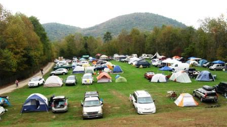

# Landscape and travel: hills, Mountain Top, waterways and crossings

[Documentation index](../README.md) · [Roadmap](../../ROADMAP.md) · [Fresh Astra review](landscape-and-travel-astra-review.md)

November 1, 2026. This records Gary's design discussion and two Astra explorations.
It is a design backlog, not an implementation, completed acceptance report, or
an apply-ready OpenSpec change. Source references describe the inspected checkout;
recheck them before implementation. Existing terrain integration acceptance remains
separate in the [roadmap](../../ROADMAP.md#terrain-integration-acceptance).

**TL/DR:** Make geography legible and useful: recognizable hills, wooded mountain
barriers with routes around them, and accessible mountain districts with broad
camping shelves. Design streams, valleys and bridges within the same landscape
and travel architecture. Preserve a path toward a later two-story hillside Barn,
without adding the Barn to this iteration. No early hill encounter is required.

Implementation subsequently began in the [execution change](../../openspec/changes/landscape-and-travel/README.md); [proof evidence](../../verification/landscape/README.md) distinguishes implemented contracts from remaining production work.

## Contents

- [Motivation and scope](#motivation-and-scope)
- [Gary's Mountain Top reference](#garys-mountain-top-reference)
- [Recognizable landforms and destination foundations](#recognizable-landforms-and-destination-foundations)
- [Mountain barriers and accessible districts](#mountain-barriers-and-accessible-districts)
- [Generation order, ownership and determinism](#generation-order-ownership-and-determinism)
- [Streams, rivers, lakes and bridges](#streams-rivers-lakes-and-bridges)
- [Support, navigation, collisions and the future Barn](#support-navigation-collisions-and-the-future-barn)
- [Delivery and verification](#delivery-and-verification)
- [Review synthesis and unresolved engineering choices](#review-synthesis-and-unresolved-engineering-choices)
- [Current-source evidence](#current-source-evidence)

## Motivation and scope

Gary reported that Locke reached game day 10 and scored over 2,000 smiles but did
not notice hills or one-wheel riders. That report motivates clearer geography;
it does not establish which deployed version Locke played or prove either feature
failed. The current terrain's broad relief and extensive zero-height grading are
verified mechanisms that can suppress noticeable elevation [E1, E2].

The discussion established these user preferences:

- Stronger visible hills and selected destinations at different elevations are
  desirable; a guaranteed hill encounter near the start is explicitly unnecessary.
- Small and large mountain barriers may have slopes Zerble cannot climb, provided
  useful routes go around them or through passes.
- Truly unreachable portions should have no people, tents, stages or activities;
  suitable trees may remain. This does not mean all mountains are unoccupied.
- Mountain Top-style districts should connect multiple camping shelves by a side
  dirt road, with a short descent beyond the upper area to a drum circle and fire.
- Rivers, streams and bridges belong in the coordinated design. The staged
  packaging below is a recommendation, not authorization to implement it now.
- A two-story hillside Barn is a later iteration, with direct outdoor access to
  each level from different elevations.
- A first-aid booth or tent is separate future work, recorded in the
  [World roadmap](../../ROADMAP.md#world). No medical gameplay was requested.

The existing flat-layout integration and its acceptance are not silently replaced
or marked complete. This direction goes beyond that work: mountain-aware roads
and waterways may intentionally change horizontal layout. Preserve random stream
discipline and repeatability, but do not promise identical placement coordinates
for a deliberately new generation version [E10].

## Gary's Mountain Top reference



Gary supplied this photograph and described it as a camping flat at LEAF's Lake
Eden property, viewed from the upper camping area. The image shows a broad grassy
camping meadow, tents and vehicles, a road along the left edge, wooded boundaries
and distant hills. The steep connection between camping levels and the drum-circle
clearing are established by Gary's narration, not measured from this single image.
This is an inspiration reference, not a surveyed map or a request for a literal
property reconstruction.

The intended sequence is:

```text
Main festival route
    -> winding side dirt-road ascent
    -> broad lower camping shelf
    -> another climb beside a steeper grassy bank
    -> broad upper camping shelf
    -> crest or junction
    -> short descending dirt road, roughly 50 yards / 46 meters
    -> smaller sheltered clearing with a large drum circle and fire
```

The approximate distance is Gary's recollection, not a fixed acceptance constant.
Each camping shelf should read as a continuous, gently uneven meadow containing
many camps. Give shelves irregular rounded outlines, variable widths and wooded
edges, rather than separate little pedestals or rectangular staircase platforms.
Players can see the next shelf above them while needing the longer road at its
side to get there. The final clearing sits beyond the crest, not necessarily at
the highest point; its reveal and separation from camping are part of the appeal.

## Recognizable landforms and destination foundations

Retain a broad regional landscape and add a small deterministic vocabulary of
elongated ridges, rounded knolls, saddles and raised meadows. Vary orientation,
length, asymmetry and spacing so individual forms have readable silhouettes.
These are proposed shapes, not additional undirected noise everywhere.

Initial tuning hypotheses were 6–12 meter rises over roughly 100–150 meters,
with an earlier 80-meter lower bound discussed. They are unmeasured. For cubic
smoothstep, peak grade is 1.5 times height/run, so 12 meters over 80 meters reaches
22.5% before other modifiers. Evaluate the combined triangulated surface and
road crossfall, not just average ascent. Current access tests enforce 20% in their
fixtures, while the cart's terrain classification allows up to 45% [E3, E4].

Shrink grading to match support needs rather than flattening every destination's
enclosing circle. Existing oriented cluster shapes provide a starting point [E5]:

| Space | Proposed treatment |
| --- | --- |
| Stage deck, continuous vendor aisle, structural standing area | A coherent level foundation with lattice-aware margins |
| Audience clearing and open meadow | A gentle usable grade, subject to activity and builder audits |
| Camping shelf | A broad coordinated meadow with limited unevenness and supported individual pitches |
| Independent camp props and tents | Reuse existing per-prop settling and tent support-plane fitting where suitable [E6] |
| Steep wilderness face | Preserve its landform and exclude occupied destinations |

Planning occupancy is not automatically a complete support envelope. Audit outer
props, guy lines, seats, audience motion, paths and attachment anchors before
reducing any protected area. Maintain exact agreement between ground triangles,
support queries and draped roads [E2, E7].

The first Astra exploration proposed isolated elevated terraces as a bounded
alternative to independently raising every venue. A terrace would contain all
compatible overlapping hard foundations, reject conflicts with external protected
areas, and taper within a disjoint transition region. Candidate priority must be
compared against all relevant candidates, not an iteration-dependent accepted set.
This remains a useful option for isolated destinations, but candidate acceptance
in dense layouts is unmeasured. It is not sufficient by itself for Mountain Top.

## Mountain barriers and accessible districts

Treat steepness, buildability and accessibility as separate properties. A flat
summit may be unreachable, while a terrace surrounded by steep slopes may be
reachable by its side road. Assess whole occupied footprints, road approaches and
connected access instead of accepting a venue based only on its center slope.

Use smaller knolls for local detours, longer ridges to separate neighborhoods, and
occasional larger masses with routes around their ends or through passes. Preserve
intended through-route connectivity and a practical return route. Proposed visual
cues include wooded moderate slopes and exposed ground or rock on extreme faces;
their art direction and cost are not established.

For an inhabited mountain, generate one bounded district plan that coordinates
the mountain form, terrace outlines/elevations, connecting dirt road, banks and
final clearing. Unlike isolated terrace candidates, this owner deliberately owns
multiple elevations and their transitions. It must also reconcile its outer
boundary with neighboring terrain, roads, districts and water constraints.

The current over-limit response stops movement [E3]. A better proposed response
would let the cart lose uphill progress while retaining a clear way to reverse or
steer around the face. Do not let reduced acceleration alone serve as the barrier:
boost, reverse, diagonal motion and long simulation steps must not bypass it.
Specify controlled recovery before introducing sliding behavior that might strand
the cart. Prevent ordinary crowd wandering and route-following encounters from
entering terrain they cannot navigate.

## Generation order, ownership and determinism

The conceptual dependency is:

```text
Seed and bounded regional identities
    -> broad landforms and water constraints
    -> feasible route connections, passes and crossings
    -> accessible destination/district plans
    -> final road, bank and foundation grading
    -> shared support geometry, rendering and runtime ownership
```

This is a proposed dependency contract, not a claim that the current modules can
be reordered mechanically. Existing roads connect festival hearts, and existing
terrain asks festival plans for pads [E2, E8]. Establish which regional anchors
exist before terrain and how infeasible anchors are resolved; avoid a loop where
destination plans query final terrain that itself requires those plans.

Separate an ungraded landscape query from final support queries. A reentry guard
returning zero is not a substitute for an acyclic design [E2]. Stable owner plans
should describe complete features; chunk windows should select their pieces, not
change the plan. Derive finite query halos from maximum influence sizes, including
neighbors that can veto a feature. Do not solve chains of overlapping pads with an
unbounded global connected-component traversal.

Use independent salts for new randomness, version intentional layout changes,
invalidate bounded caches by seed/version/configuration, and retain stable feature
identities through unload/revisit. Resolve conflicts with a defined priority and
fallback, never loaded-object order. Large mountains need bounded descriptors and
local geometry, not one permanently resident giant detailed mesh.

## Streams, rivers, lakes and bridges

Plan watercourses with stable ownership, routes, junctions, downstream levels and
bounded influence. Shape valleys and banks to their water profiles, rather than
drawing a blue ribbon on arbitrary hills. A regional network must define continuity
at boundaries and what happens at tributary junctions and outlets; a local downhill
segment alone does not establish a coherent river network.

The earlier recommendation to retain lakes at zero works for selected lowland
anchors, but it is not a universal rule for connected mountain hydrology. Explicitly
resolve which streams meet which lake levels, which water bodies are independent,
and how waterfalls or other drops would be represented if introduced. There is no
current river implementation: `onRiver` and `bridge` are false placeholders [E9].

Choose crossings jointly with roads: practical crossing width and angle, stable
bank elevations, a deck above water and smooth supported approaches. Roads should
use passes or go around barriers rather than blindly climbing them. Do not assume
a bridge model alone makes the route traversable.

Narrow streams and cut banks may be smaller than the live 10-meter ground lattice
[E1]. Decide a shared local refinement or constrained feature-width strategy before
claiming visible channel geometry matches collision/contact. Overlaying a detailed
water mesh does not cut a channel into coarse ground. Bound refinement, avoid seams
and compare near/far representations.

Package waterways and crossings with the landscape design, then deliver complete
stages. The recommendation is to prove one functional representative stream and
bridge before declaring the coordinated feature complete. The prior river
window-invariance problem must receive an explicit regression test [E9].

## Support, navigation, collisions and the future Barn

Distinguish terrain/riverbed height, water level, and a traversable support such as
a road or bridge deck. A proposed support query can include stable surface identity,
height, normal, material and allowed connections, selecting support with the mover's
current surface/elevation and movement intent. Do not automatically select the
highest surface or snap to another floor merely because it shares X/Z.

The current cart uses the terrain sampler directly, registry broadphase uses
horizontal coordinates, and contact resolution checks horizontal radii without
elevation [E11, E13]. Adding support selection alone will not fix collision,
avoidance, proximity interactions, seating, boarding or navigation across floors.
Keep horizontal broadphase where useful but add vertical/surface eligibility at
the relevant narrow-phase and interaction boundaries. Different surface identities
must not exempt a tall solid that physically intersects both levels. Reuse the same surface and
ownership contracts for carts, people, road riders, dropped props and physics
colliders, without requiring the arcade cart to become a rigid body.

Decide explicitly whether the first bridges allow passage underneath. Preserve the
ability to represent stacked supports, but do not build a general indoor navigation
system just for the first crossing. The future Barn requires two floors, ground
access at each elevation, and correct separation of actors and interactions. Its
building model, interior, stairs and activities remain later work.

The concurrently developed physical-festival fixture is not proof of production
terrain physics integration [E12]. Coordinate the geometry/version/ownership
boundary so chairs and other bodies eventually use the actual landscape and bridge
surfaces instead of a separate approximation.

## Delivery and verification

These are recommended milestones, not a completed task checklist or a scope approval.

1. **Build the inspection surface.** Extend terrain/map/hub tools to expose landform
   owners, foundations, slopes, road profiles, occupied-area access, water levels and
   support identities. Keep existing terrain acceptance visible and separate.
2. **Prove a complete mountain district.** Produce readable hills and wilderness
   barriers plus a coordinated lower shelf, upper shelf, side road and descending
   drum-circle clearing. Verify access and driving before expanding generation.
3. **Integrate bounded generation.** Establish regional conflict/ownership rules,
   route feasibility and destination placement, then prove repeated streaming and
   map/runtime agreement across multiple seeds and negative coordinates.
4. **Prove a functional water crossing.** Include actual channel/bank geometry,
   consistent water profile, bridge support, approaches and participating movers.
5. **Complete release acceptance.** Run current project checks/build and a real
   title-gesture boot; capture Noon/Midnight and Low/Mid/High; measure cold planning,
   streaming/allocation and parked costs separately; retain physical-device checks.

Meaningful acceptance must include:

- Identical feature plans across query windows/order, cache eviction and
  unload/revisit; no seam changes at ownership boundaries or near/far handoffs.
- Mesh/contact agreement on foundations, slopes, road edges, channels and decks,
  including whole footprints and all four wheel supports.
- Feasible connected routes to every occupied shelf and clearing, with sufficient
  width/turning room, tested climbing/braking/parking and bounded detour lengths.
- No barrier bypass by boost/reverse/diagonal, frame-rate variation or collision
  pushback, and no unrecoverable boundary state. Check all relocation paths, not
  only normal driving. Prevent inaccessible crowd/activity destinations.
- Water never rises downstream except for an explicitly designed water feature;
  consistent confluence/outlet levels, dry usable decks and correct bank joining.
- No cross-floor collisions, attraction, seating or support snapping; no dropped
  props falling through a visually present deck.
- Camera crest/side-slope clearance and readable elevations from real driving views.
- Bounded cold generation, caches, geometry refinement and disposal; actual phone
  evidence before claims about mobile performance.

Browser automation must follow the [cleanup rules](../browser-verification.md).
Do not run `bin/layout-snapshot capture` while its local safety prohibition remains.

## Review synthesis and unresolved engineering choices

The first Astra exploration favored recognizable landforms, smaller meaningful
grading areas, bounded selective terraces, lowland lake anchors, and testing existing
road/camera behavior before replacing it. Subsequent user input broadens that into
coordinated multi-terrace mountain districts and water-aware route planning.

The [fresh Astra review](landscape-and-travel-astra-review.md) independently challenges
that expanded scope. The resulting design refinements are:

- **Admit complete districts after route feasibility.** Give each district finite
  influence and connection ports; validate a supported approach before committing
  occupied destinations. Use a deterministic alternate form or rejection if no
  route fits. Regional connections and district-local circulation are separate
  planning responsibilities, so the conceptual pipeline above allows district
  candidates/ports before routes and commits their occupied content afterward.
- **Validate the driven corridor.** Check both road edges, crossfall, joins and
  the cart's swept footprint through switchbacks. A passable centerline is not
  enough. Use the real controller to establish turning needs rather than inventing
  a generic minimum turning radius.
- **Make every position change obey terrain limits.** Contacts currently push
  the cart horizontally after driving [E13]. Revalidate those corrections and
  relocation/boarding paths, or an otherwise valid boundary can still be bypassed.
- **Separate support, solids and navigation.** A correct deck height does not
  prevent phantom contacts, route offsets leaving a bridge, or actors seeking a
  destination through a steep bank. Do not mistake grounded feet for valid paths.
- **Start with complete finite stream systems.** Give each a declared receiver
  and bounded owner. Cross-region rivers need agreed boundary ports/elevations
  before either interior is planned. Coordinate final grading with accepted water
  and road envelopes so a later foundation cannot dam a stream or spoil a climb.
- **Measure coverage honestly.** Record district admission/rejection rates,
  detour cost and player recognition across seeds. Finite surveys need stated
  resolution/halos and do not prove connectivity of an infinite road network.
- **Replace obsolete tests deliberately.** Existing tests freeze horizontal
  layout, a shared zero datum, gentle slopes and a ±15-meter envelope [E4]. Keep
  equivalent determinism and geometry protection under versioned new contracts,
  distinguishing accessible routes from deliberately impassable faces.

These are adopted planning recommendations, not measured implementation outcomes.
The review's additional creative suggestions include visible saddle silhouettes,
roads disappearing around wooded slopes, and ordinary-exploration recognition tests
that record encounter opportunities separately from whether a player noticed them.

Engineering choices to resolve before implementation include regional ownership and
route fallback, local refinement policy, exact support/interaction identity, initial
under-bridge access, lake/outlet levels, and numerical driving/detour/performance
budgets. These can be developed through fixtures; no additional user decision is
required merely to preserve this discussion.

## Current-source evidence

| Ref | Verified source and relevance |
| --- | --- |
| E1 | [Terrain constants/base field](../../src/worldgen/terrain.js), lines 12–39: 10-meter lattice, 90-meter shoulders, 800-meter field and ±15-meter hash envelope. |
| E2 | [Terrain descriptors/composition](../../src/worldgen/terrain.js), lines 41–51 and 107–139: zero-height protected circles, planning guard, masks and exact triangle sampling. |
| E3 | [Terrain drive](../../src/terrainDriving.js), lines 17–44, and [terrain classification](../../src/worldgen/terrain.js), line 139: grade effects and stop-on-nontraversable behavior. |
| E4 | [World-terrain tests](../../bin/test-world-terrain), lines 11–27, 33–55 and 64–89: frozen layout/relief contracts, compatible pad samples, access-grade fixtures, query order and eviction. |
| E5 | [Cluster shapes](../../src/worldgen/tuning.js), lines 268–316: oriented occupancy and separated stage/audience shapes. |
| E6 | [Camp terrain fitting](../../src/campRegistry.js), lines 40–76: per-prop settling and sampled tent support. |
| E7 | [Road construction](../../src/chunks.js), lines 838–866; [terrain triangle clipping](../../src/worldgen/terrain.js), lines 151–197; [camera clearance](../../src/camera.js), lines 72–84. |
| E8 | [Road ownership](../../src/worldgen/roads.js), lines 1–16; [chunk selection](../../src/worldgen/placement.js), lines 74–94: stable whole-route ownership and plan selection. |
| E9 | [Layout query](../../src/worldgen/index.js), lines 48–75: river/bridge stubs and current no-build composition; [river backlog](../../ROADMAP.md#world-generation-procedural-map): recorded window-invariance concern. |
| E10 | [Existing integration decisions](../../openspec/changes/varying-elevation/README.md#key-decisions): preserve horizontal layout for the earlier bounded integration; mountains/new routes explicitly require later scope. |
| E11 | [Cart sampler](../../src/main.js), lines 431–433; [registry contract/grid](../../src/registry.js), lines 45–77: terrain support and X/Z indexing. |
| E12 | [Physics fixture](../../src/physics/runtime.js), lines 20–35 and 97–102: experimental plane fixture and explicit production limitations. |
| E13 | [Collision contacts](../../src/collisionContacts.js), lines 25–29 and 48–53: horizontal-only contact overlap and post-contact position correction. |

The photograph and Gary's narrated requirements are user-provided evidence. Shape
choices, architecture, staging and numerical tuning hypotheses above are proposals.
No implementation tests, browser experiments or performance measurements were run
for this design record.


## November 1 implementation reference corrections

Gary inspected the populated workshop and clarified that its initial narrow strip and regimented camp grid did not describe Mountain Top. The usable meadows should be roughly twice that first width. The **lower meadow** has denser camping in loose, compact groups, with open driving lanes and pitches around its edges. Those lanes bound camping, but pitches should not line up into a parking lot.

The later upper-meadow 360-degree photographs refine the distinction: the **upper meadow** is substantially more open, with scattered, irregular camps near the treeline and a broad shared lawn. Preserve the view down over the lower meadow. A built-in firepit belongs to this upper lawn and is separate from the drum circle. The sculpture in the historical photograph is useful as a historical visual reference; Gary has not confirmed that it remains on site, and its recreation is not an implementation requirement.

The main road runs along the **right** of the camping meadows, rises to the next meadow, then turns **left beyond the upper meadow**. A smaller path branches from that turn and descends through **dense woods** into a separate, sheltered drum-circle/fire clearing. An exposed drum circle beside the camping shelf does not represent that sequence. “Right” describes this authored approach and can rotate with future generated districts.

The screenshots below are user-provided historical references, not a surveyed plan or evidence of current property fixtures.

- [Upper meadow overlooking the lower camping, sculpture and built-in pit](assets/upper-meadow-overlook.png)
- [Upper meadow open lawn and scattered edge camping](assets/upper-meadow-open-lawn.png)
- [Upper meadow tents and shelters against the treeline](assets/upper-meadow-edge-camping.png)

The workshop implementation now uses these distinctions. Its exact dimensions, counts, grades and render costs remain engineering measurements in the [verification record](../../verification/landscape/README.md), rather than claims about the real property.


## District families, rather than copies

Gary explicitly clarified during implementation that the infinite festival should not repeat an identical Mountain Top map. The authored workshop proves one spatial arrangement; procedural admission must generate a family of coherent places. Vary meadow outline, breadth, spacing and elevation, road alignment and bends, camping groups/density, treeline and wooded descent, and optional social landmarks. Retain the important relationships: usable elevated camping, readable steep banks, feasible ascent and a coherent approach to any separate gathering clearing. The number/configuration of terraces and the presence of a drum clearing or meadow firepit may vary across declared forms; the real-property reference does not require every instance to contain the same furnishings.

Derive terrain, protected ground, travel routes and population from the same deterministic plan. Merely rotating the same map or randomly scattering props over a fixed terrain does not satisfy this variation requirement. Keep a small bounded set of validated form families and seeded parameters, verify that different seeds produce structural variation, and retain exact repeatability for the same owner/seed/version. The existing authored fixture stays useful as a regression test.

Related future ideas are recorded separately in the roadmap: varied vehicle models for car-camping setups, and a passenger asking “Take me to the mountaintop.” Neither requires new vehicle models or a quest system during the current landscape implementation.

### November 1 playtest follow-up: physical climbs and denser lower camping

Gary clarified that steep terrain must never act as an invisible vehicle wall, uphill resistance must follow power and momentum, and Zerble must always be able to descend supported hills. This supersedes the earlier hard driving-grade barrier idea; conservative placement and walking route limits still apply. He also requested much denser, tightly packed lower-meadow camping when integrated into the world, with the sparse upper lawn retained. The generated proof now implements these distinctions, and the active execution change records remaining production integration and acceptance.
