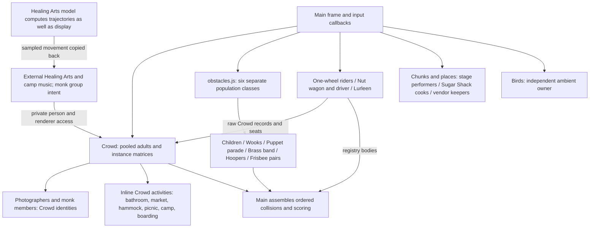
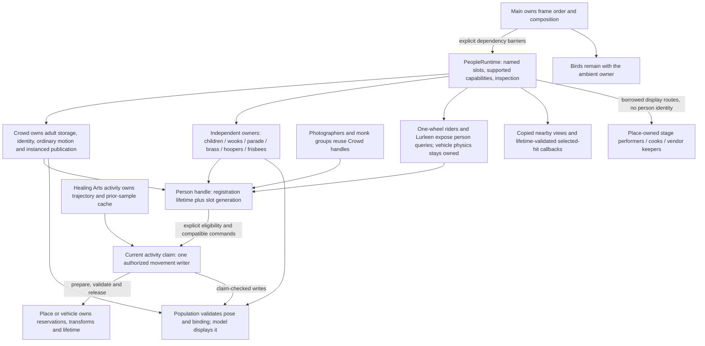
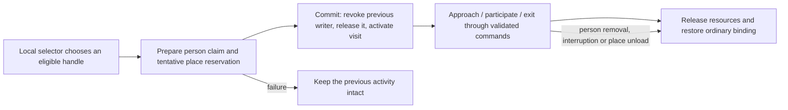

# Festival people, before and after

**TL;DR:** The characters retain their different brains and bodies, while the
connections between owners become explicit. A population owns a person's lifetime,
an activity can temporarily borrow movement, and the place or vehicle owns its
resources. Registration makes supported participation discoverable without making
every person eligible for every behavior.

The before view is anchored to immutable revision
`9eaf2e5d73419f7c926c11ab06882f007b2bf1e4`, with file/line evidence in the
[before ledger](coverage-ledger.md). The after view describes the working
implementation, with [all 17 families and executable evidence](acceptance.md),
[exact dependency slots](dependency-slots.md) and the
[population/venue eligibility matrix](extension-guide.md#population-eligibility-matrix).

## Before: connections depended on the particular family

The shared ownership idea already existed in places, but there was no consistent
boundary for it. For example, a monk or photographer was already a Crowd person,
while a child belonged to an unrelated obstacle class. Main had to know the
individual update, reaction and collision paths, and some borrowers reached into
Crowd's renderer. This diagram does not claim the former game had no owners.

## After: common connections, specialized owners

The activity arrow is a capability boundary, not a statement that every registered
family implements adult activities. One-wheel/Lurleen facets are query-only,
children retain their own behavior, and decorative people acquire no interactive
lifetime merely because they look human. The wagon driver remains the same Crowd
person when the vehicle releases him.

## What happens when a person visits a place

For a stage, the adapter can supply audience destinations or reserved standing
spots. For a potty, it supplies a live stall, door and safe exit. For a food truck,
a new service adapter supplies its counter and queue rather than treating a truck
collider as a vendor. Healing Arts supplies rig slots and motion constraints, while
the wagon supplies moving seats. The behavior reads these contracts instead of
switching over every combination of NPC family and venue. The executable
[two-population, two-place, two-binding proof](../../../verification/people/extension.html)
demonstrates this connection without changing live eligibility.

## What stayed deliberately separate

| Responsibility | Before | After |
| --- | --- | --- |
| Lifetime and removal policy | Crowd pool, independent global populations, chunk places and vehicles | Same policies, with validated handles and ordered cleanup |
| Movement | Family logic and several private cross-owner writers | Family logic or a current validated activity; vehicle physics stays vehicle-owned |
| Rendering | Adult instancing and specialized model rigs | Same render strategies, with explicit borrowing/restoration |
| Interactions and collisions | Main enumerated families and retained raw targets | Declared ordered providers, copied views and selected-hit callbacks |
| Frame order | Carefully interleaved family calls, collection, streaming and scoring | Named dispatch at those same barriers, including adult-before-collection and child-after-collection |
| Places and resources | World/vehicle-owned resources with inconsistent borrowing seams | Resource ownership stays local; reservations and release validate exact lifetimes |
| Animation clocks | A mixture of wall time and supplied delta | Accepted gameplay time for actors, with profiling/audio/streaming clocks separate |

The measured topology is unchanged under matched Low/Mid initial conditions.
There is measurable CPU validation cost, and muted Mac tests do not establish
physical iOS audio or phone performance; see [the evidence and limits](acceptance.md).
