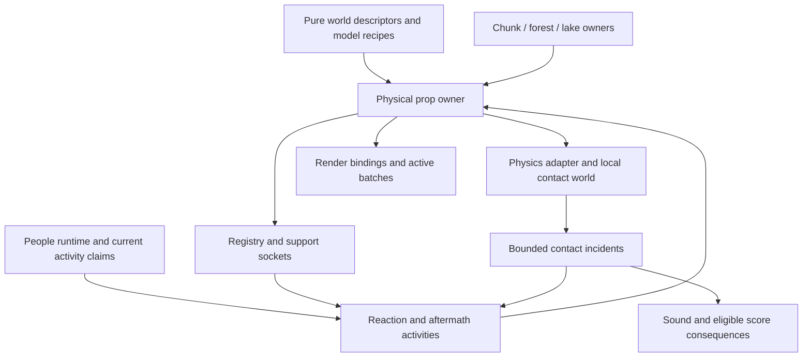

# Physical festival design

## Context

This is a proposed architecture, not an implementation report. [Evidence](evidence.md) records today's separate disc-based collisions, instanced chairs and drinks, camp reservations, material-grouped cooler, deterministic roads and independent world owners. [Ideas](ideas.md) preserves the experiential ambition; [tasks](tasks.md) specifies the dependency order.

The first complete target is one occupied-chair incident with coherent recovery in a real campsite. Empty-chair feel and lifecycle are the first acceptance gate inside that target. The cooler follows as the next distinct prop, then cups, useful signs and social aftermath.

## Goals / Non-Goals

**Goals:** believable contact-driven variety; purposeful human reactions; bounded mobile cost; identity and ownership that survive motion; route-truthful signage; reuse of the current drink and activity systems; repeatable verification before broad rollout.

**Non-goals for the initial delivery:** replacing cart handling; simulating every distant prop; universally enrolling every population; full articulated crowd physics; structural/cloth/fluid simulation; historical displacement persistence; automatic repair of all sign types. [Ideas](ideas.md) preserves these distinctions without dropping the larger ambition.

## Decisions

The dependency direction is deliberate: world generation describes objects, the runtime owns their identities and lifetimes, and physics/rendering provide replaceable representations. Person activities borrow authority from the existing people runtime.

Proposed module boundaries, to confirm against the source baseline before creating files:

| Responsibility | Suggested home | Boundary |
| --- | --- | --- |
| Logical prop lifetime, admission and ownership transitions | `src/physicalProps.js` | Coordinates adapters; no direct mutation of private person storage |
| Engine and fixed-step details | `src/physics/` | Owns engine handles; exposes finite copied state and bounded events |
| Chair/cooler/cup/sign geometry and immutable sockets | `src/models/` | No simulation loop or registry singleton access |
| Part-instance bindings and active render pool | `src/propRendering.js` | Owns slot generations, dirty updates, bounds and graphics disposal |
| Temporary reaction, righting and retrieval activities | `src/people/` | Uses live claims and capabilities, not renderer indices as identity |
| Sign intent and bounded route evidence | `src/worldgen/wayfinding.js` | Pure data with injected clearance evidence; no Three.js or live registry import |
| Repeatable encounter orchestration | Dedicated interaction entrypoint | Imports production implementations and owns their teardown |

### 1. Separate identity, simulation and presentation

Introduce a proposed `PhysicalProps` owner with logical records containing stable `propKey`, generation, kind/recipe, origin owner, current pose, state, render binding, optional body handle, support sockets and incident metadata. Runtime registry IDs and engine handles are references, never logical identity.

A generated key derives from world seed/epoch, owner identity, semantic role and stable local slot. Never derive it from load order, registry insertion ID or an extra draw in an established RNG sequence. Runtime dropped objects use a visit-local identity bound to the source person/slot generation. Keys distinguish two cups from the same cooler and both seats of a loveseat.

The existing chunk/forest/lake owner supplies installation and teardown. The physical owner manages explicit adoption of moving props and reconciliation with origin regeneration. It must not mutate `chunkKey` in place and assume indexes update. Implement a tested registration/transfer API or remove/re-add with all consumers explicitly rebound. Original-owner manifests suppress duplicate regeneration while an adopted prop exists elsewhere. Suppression keys and dormant enrollment exist only for the live neighborhood and currently adopted objects. Coherent distance reset removes obsolete metadata; there is no history of old displaced poses. Unchanged dormant props are reconstructed from deterministic descriptors. A live adopted object pins only its temporary suppression key, so returning to its origin cannot clone it while it is still being followed or carried.

### 2. Bounded local simulation with a fixed time step

Evaluate a pinned Rapier package behind a narrow adapter for world/body creation, pose/velocity, contacts, constraints, sleeping and removal. Do not wrap the entire engine or expose engine handles through people APIs.

The [external research synthesis](research-synthesis.md) retains this choice as an experiment and corrects the reports' obsolete build premise. Prove the selected distribution and JavaScript APIs against the current Vite deployment. Start on the main thread; worker transport is a conditional measured alternative. Collision start/end, sensor overlap and measured contact forces are distinct inputs, and application rules own sign/latch release unless the pinned engine API proves otherwise.

Use a fixed step, initially 1/60s for the experiment, with an accumulator, interpolated render poses and a bounded substep count. Consume the existing accepted gameplay delta, not a second RAF or independent wall clock. Passport/gameplay pause freezes physics with the other gameplay systems. A hidden tab that continues through the current timer scheduler continues physics too; genuinely suspended execution discards excess elapsed time on return instead of applying one giant step. Capture/input locks retain their existing clock semantics, and must not be conflated with a paused simulation. Record the policy and tests. Teleports reset the cart proxy history and nearby activation state, never sweeping a phantom cart across the world.

Prewarm nearby props before predicted contact. Maintain one bounded simulation world with active neighborhoods around Zerble and retained moving objects, including simple static collision proxies for nearby trees, tents and other relevant solids. A static environment proxy is distinct from making that environment destructible. Continuous collision detection or swept activation covers fast small objects; pin supporting terrain while bodies use it. Include hysteresis to avoid repeated create/destroy near the activation boundary.

States are `dormant`, `resident-sleeping`, `active`, `settled`, and `released`. A dormant prop has a pose and logical identity but no body. A sleeping resident still has collision presence and body storage. Settled bodies can retire only after dependency checks: a supported stack cannot lose its lower collision surface. Keep connected support/contact groups resident or bake a valid static proxy before retirement.

Set hard capacities for bodies, colliders, joints, adopted objects, render slots, terrain tiles, incident records and temporary ownership metadata. Measure allocation and steady-state costs separately. Preserve already active/support-critical objects under pressure; reject or simplify new optional small props before evicting visible interacting bodies. Final numeric limits are outputs of the device gate. Until then, the fixture uses explicit configurable limits and exposes every overflow. Storage limits are separate from per-frame creation/work limits: cap queued admissions and body/collider creations, and allocate terrain/static-proxy/sign work within the existing world streaming allowance. A deadline check before one long synchronous build is insufficient; split preparation into bounded units and measure their worst observed cost. Do not add a second full streaming allowance.

Before activating a supported assembly, reserve the body/collider/render/event capacity needed for its maximum mandatory releases, including both loveseat occupants and associated cups. Optional admissions cannot consume this reserve. If the reserve cannot be obtained, keep the entire assembly on its coherent legacy/nonphysical path until admission is possible. Voluntary transfer can roll back; unavoidable support loss must use reserved capacity and cannot leave an object attached to a vanished support. Maintain a bounded mandatory-transition queue with admission/backpressure, while cosmetic sound/particles can be coalesced or dropped. Never discard required claim or penalty transitions silently.

### 3. Cart coupling and contact authority

Zerble's controller remains the driving authority. A kinematic body tracks the cart's accepted motion each fixed step. Dynamic objects receive the solver's contacts; a bounded gameplay feedback rule adjusts the controller's speed/jolt from impact evidence. Never apply both a hand-authored launch impulse and the full solver impulse for the same contact.

Route each physical prop/person candidate to exactly one contact owner. Remove it from the legacy response path while retaining avoidance/spatial publication. Non-participating objects continue through the existing resolver. A candidate can publish a conservative 2D footprint for NPC avoidance while its actual physical collisions use a 3D shape.

Physics continues during damage invulnerability. Star-power ghost mode changes cart collision filtering explicitly; turning it off while overlapping a prop needs a bounded separation policy. Debug teleport, rescue, mode restart and tier change each have a named reset transition. Preserve the existing stationary-cart protection from crowd nudging and protected population participation rules.

#### Production frame contract

The proposed integration uses the existing late contact barrier, after collection, streaming and same-frame star activation. Ordinary steering deliberately sees the latest previously solved prop state; physics reactions and final presentation consume the new result in the same frame. This bounded one-presentation-frame steering latency avoids introducing a second people scheduler. Prove this arrangement with the existing frame trace before accepting it; any required barrier change must be explicit and regression-tested.

| Order | Authority and publication |
| --- | --- |
| Accepted tick | Use the existing gameplay delta/gates. Restore authoritative solved transforms before queries; interpolated display state never becomes simulation input. |
| Cart and ordinary people | Record cart motion samples with timestamps; run current vehicle, spatial and adult barriers once. Steering reads the last solved footprints/sockets. |
| Existing collection and world work | Preserve collection/scoring order, bounded streaming, then star update. Sample the resulting ghost eligibility for the contact pass. |
| Legacy contacts | Resolve only non-migrated candidates in their existing order. Reconcile their cart correction into the accepted trajectory before feeding the proxy; tag position corrections/teleports so they are not interpreted as high-velocity travel. |
| Fixed substeps | Sample the accepted cart trajectory at each step boundary, never send the same new endpoint repeatedly. With zero steps retain authoritative state; with multiple steps consume the corresponding time intervals. Current ghost eligibility applies before contacts. |
| Post-step mandatory transitions | Drain support-loss and claim transitions at a safe mutation barrier before another substep; process newly released bodies through reserved capacity. Aggregate eligible incident consequences without rerunning ordinary activities. |
| Final publication | Publish solved prop/person poses, footprints and sockets; refresh affected spatial entries before recovery/clearance queries. Apply bounded cart feedback once, with speed feedback affecting the next controller update. |
| Presentation | Republish only affected person/held-item bindings through a pose-only path, without advancing activity clocks again. Interpolate parents and attached children from consistent pose samples; emit bounded sound/score feedback and render. |

The trajectory sampler must define how current variable-frame cart motion is reconstructed between accepted samples; the fixture compares invariants under equivalent input at 30/60/120Hz, not an unsupported promise that the existing variable-step controller is bit-identical. Tests include a legacy wall beside a physical chair, star pickup on the contact frame, a chair crossing a spatial cell, and zero/one/multiple substeps. Preserve first-hit legacy behavior for remaining candidates; any change to simultaneous-hit prioritization is an explicit policy test.

### 4. Rendering and world ownership

Chair builders expose immutable part-local matrices and stable render-slot bindings before batching removes meshes. Rendering composes parent/world transforms correctly, updates dirty instance matrices and maintains conservative bounds so an airborne chair is not culled at its old position. Measure GPU upload cost; setting one dirty flag can upload more than the one changed chair, depending on buffer/update strategy.

Keep world-owned active render capacity available when a prop leaves an origin batch that is unloading. Transfer visibility exactly once: acquire the new binding, publish its pose, hide/release the old slots, and release ownership metadata in a tested order. It is acceptable to use a small active batch pool rather than hold a whole distant campsite alive for one chair. Shared geometry/materials remain shared and are never disposed through prop teardown.

At every final solved-state publication, update registry position, footprint and any seat/holder transforms before dependent queries; settlement additionally changes availability/residency. Conservative footprints account for a sideways chair's extent, not just its original upright radius. Recovery requires actual clear approach/exit points and upright stability.

#### Procedural clearance versus live avoidance

Existing builders consult live registry clearance and some rejection paths skip later RNG-consuming construction. Therefore unchanged salts alone do not preserve generation when furniture moves. Introduce a narrowly scoped canonical-clearance view for affected generation queries that retains original blocker geometry and established builder ordering, while runtime avoidance/contacts use displaced geometry. New signs/cups are excluded from old generation guards unless deliberately included by a separately verified layout change. Inventory chunk, forest and lake clearance consumers; do not globally alter their semantics as incidental cleanup.

When newly loaded canonical scenery intersects a displaced runtime prop, detect overlap before publishing the new solid and retain valid supporting ground. First attempt bounded contact separation into a verified clear nearby pose, without a second collision authority. Never visibly teleport/reset the displaced prop. If no safe visible reconciliation exists, hold the conflicting new solid's render/collision publication in bounded pending work and stop optional admissions in that region; retry as motion clears it. A distant unobserved runtime prop can instead retire through the documented distance-reset policy. Preserve the canonical descriptor throughout, and test maximum pending capacity so waiting does not become unbounded chunk retention. Preserve original-content descriptors for the same seed and load order with different prop displacement/sign timing. Test exploration-order behavior against the existing baseline separately; do not claim global world-order invariance that the old implementation has not established.

### 5. Ground, streaming and distance-based reset

Build collision terrain from the same samples and triangle split as the rendered terrain, including disabled/flat mode and adjacent tile boundaries. Preserve forests' and lakes' separate ownership; an absent `chunkKey` is not an invitation to attach a lake prop to whichever chunk happens to contain it.

Gary approved distance-based reset after the initial council. Retain changed poses only while an arrangement remains in the live neighborhood or is temporarily adopted because the player can still observe/interact with it. Once it is beyond the loaded-neighborhood reset boundary plus hysteresis, unobserved and free of relevant live dependencies, release its state and regenerate the deterministic original arrangement on the next visit. Merely turning the camera away or crossing a nearby chunk boundary is insufficient. Choose the actual distance/buffer from existing streaming behavior and a visible-reset fixture, rather than invent a magic radius here.

Reset a local arrangement coherently: stop new interactions, cancel eligible unseen recovery tasks, detach or transfer live support/holder claims, release constraints/bodies/render bindings, then clear temporary metadata. Active visible participants and their supports cannot disappear. A cup carried by a still-live nearby person, or a chair that the player follows out of camp, keeps its temporary identity and origin suppression until it too is safely released. Resetting the original campsite does not clone that item or teleport it home. NPC lifetime remains with the population owner; prop reset never respawns a person or resets their personality. Unseen cancellable claims cannot pin abandoned areas forever.

There is no displaced-pose serialization, saved visit history, history eviction policy or cross-session debris store. Stable procedural keys remain useful for avoiding live duplicates and recreating original placements. Long-term discoveries, scores, reward eligibility and other progression keep their own existing policies; resetting a physical arrangement must not make a consumed reward collectible again. Chair righting and cup retrieval remain optional local behaviors, not infrastructure required to keep the world tidy.

At the bounded simulation frontier, do not let objects fall through missing terrain. Maintain a safety margin and cap travel/energy through ordinary damping; if a hard limit still requires retiring an unseen object, perform coherent distance-reset cleanup through a logged transition once the reset conditions hold. Never pin unbounded chunks or teleport a visible body to conceal exhaustion.

### 6. Occupied chair and person reaction authority

Use the existing population identity and activity claims. A physical reaction is a temporary activity/capability that borrows movement and optional rendering authority. It neither accesses raw crowd records from the physics module nor becomes a new lifetime owner. Each phase publishes through the existing accepted-motion schedule.

Before an occupied origin can unload, synchronously acquire a reaction-owned support resource and transfer each sitter through the existing activity preparation/rollback contract. Preserve the stable seat key while replacing the old campsite entry/slot token with a validated reaction support token; do not weaken `campSlotValid` or keep the whole campsite alive. Release the old claim only after the replacement support and required capacity are secured. A failed adoption keeps the old valid resource until a bounded safe dismount/release resolves it. Old-owner cleanup after successful transfer cannot release the replacement token. Camp music and both loveseat occupants require separate explicit transfer tests.

The chair exposes per-seat support sockets. While supported, the sitter contributes a configured mass/center-of-mass approximation; their normal world collision proxy is filtered from the chair to avoid self-contact and duplicate mass response. Model bracing as a bounded control rule, not unbounded corrective forces. Stability hysteresis prevents rapid switching between seated and falling states.

At release, compute seat-point velocity as `v + omega × r`, add only the chosen dismount action, and remove the occupant load in the same transition. Verify finite state, continuous pose and bounded energy; this approximation need not conserve every detail of a full human simulation, but it must not double-count mass or create launch spikes. Restore collision filtering only after safe separation. The chair and person use real world scale, independent of model parent transforms.

For controlled dismounts, require a clear reachable foot/exit target. For unavoidable falling, release the seat even when the old walking exit is blocked, then find recovery space from the actual landing pose. Never reuse the current trapped-sitter early return as an indefinite physical attachment. A simple body proxy is the first fall model; decorative limb animation remains consistent with its pose.

After settling, select a clear stand-up pose, blend to ordinary animation, and release reaction authority once. A second impact updates the current reaction instead of creating a competing owner. Despawn, activity replacement, owner removal and reset stop writes before resource cleanup. Loveseats apply these rules independently per occupant.

### 7. Cooler articulation and support sockets

Expose the actual cooler group through kitchen/camp descriptors. Its body, registry entry and physics pose must move together without moving the canopy currently referenced by the collider metadata. Keep the closed cooler as one rigid body for the first proof.

Add named cup-well sockets with local position, upright axis, support depth, maximum cup size and capacity. Derive them from model dimensions, not duplicated placement literals in the simulation.

For the lid phase, split the current cream geometry into actual lid parts and body-mounted details, preserving shared pooling and appearance. Add a hinge transform and bounded hinge limits; a latch is a rule controlling release. Revalidate holder transforms as the lid moves. Contents use a capped pool and explicit release, not a spawn per contact. A mechanical hinge and a posed lid animation are alternatives to compare in the fixture before selecting the least complex adequate implementation.

### 8. Drinks, hands and holders

Refactor the existing beverage visual into a reusable local-origin recipe while preserving its appearance, color selection and ordinary-crowd participation. Keep immutable appearance (`hasDrink`) separate from current possession; a dropped cup must not respawn because the appearance bit is still true.

A cup has exactly one state: `held`, `in-holder`, `supported`, `free`, or `retired`, and at most one logical owner/claim. Transfers acquire the destination, publish one representation and release the source as a coordinated operation with rollback. For voluntary transfer, engine failure or pool exhaustion leaves the original valid state intact. Mandatory support loss uses the pre-reserved release capacity described above; preserving an invalid source is not a fallback. Person despawn either transfers a retained drink coherently or retires it through the documented ownership policy.

Hands are capabilities with availability, not a universal right-arm offset. Existing instrument, camera, hoop, boarding and hidden-pose activities retain their exclusions. First preserve their current hiding behavior as an explicit presentation state; later put-down/sip actions use the same claim-checked hand authority. Do not enroll specialist populations by accident.

Use cheap attachment/support approximations for a cup resting securely in a holder; release when measured tilt/acceleration/contact exceeds tuned thresholds. On release, preserve the support-point motion and show only the free representation. Enable local physics only when needed, and prioritize correctness of transfer over simulating tiny idle objects. A cushion-supported cup blocks that seat until removed. Spills are optional pooled visual/audio effects with no fluid solver.

### 9. Useful sign planning and damage

Implement sign intent in the pure world-planning layer. Inputs are canonical road/approach descriptors, stable destination descriptors and injected clearance/access evidence. Outputs contain stable sign key, owner key, pose, readable face orientation, selected destinations, route/next-hop evidence, style and damage recipe. Rendering/registry dependencies never flow into pure worldgen.

Construct a bounded local decision graph only from verified connected road segments and validated destination approaches. Do not claim a general routing graph already exists. At an actual branch or important entrance, rank useful reachable destinations, deduplicate same-direction blades, and choose a sparse subset with a deterministic tie-breaker. Arrows follow the first outgoing segment; a clear direct approach is allowed only when its corridor is proven. Prefer no sign to an unsupported route. Avoid global pathfinding over the infinite festival.

Candidate ownership must be canonical across overlapping chunk queries. Placement respects road shoulders, sight lines, doors, NPC approaches, existing solids, water and terrain. Built-world rejection of the target or its approach invalidates its blade; never create a convincing pointer to an omitted POI. Cache per immutable world/epoch descriptor, not live registry insertion order. The placement adapter supplies destination/access evidence with stable destination identity, epoch, revision and explicit `unknown`, `accepted`, or `rejected` state. A missing live registry entry due to unload is not rejection. Validate unknown candidates through bounded deterministic placement/access proof or an explicit adapter evaluation; hold the blade unpublished until proven. Do not force-load the destination's render chunk. Genuine placement/access rejection invalidates only the affected evidence/blade. Test destination-first versus sign-first loading and destination unload/reload.

Bound graph nodes/edges/query work, label cache count/bytes and invalidation by epoch. Incremental planning/label preparation consumes the shared streaming allowance; do not introduce a worker until measurements demonstrate that need. Keep sign labels consistent with useful map vocabulary without modifying map discovery or giving hidden POIs away.

Begin with one readable sign family. Distinguish standing, fallen and flattened/folded conditions. Apply physical orientation to blades and text. Damage state changes collision/avoidance footprint and remains with the live prop until its arrangement qualifies for distance reset. Automatic repair is disabled by default. Disabling a blade after target validation failure is a semantic change; ordinary damage does not magically rewrite an arrow toward a new place.

### 10. Incidents, feedback and aftermath

Create an incident when a meaningful primary contact begins. Carry source, original instigator, bounded age/hop count, target identities and per-target response history through relevant secondary contacts. A chair striking a person can retain causal attribution; an old resting prop does not carry an eternal blame tag. Renewed deliberate impacts can start a new incident after separation/cooldown.

Deduplicate penalties per affected person/eligible event, not merely once globally (which could make plowing a crowd free). Keep material sounds, social reactions and scoring separate. Preserve existing numeric penalties/strikes initially; evaluate gentle empty-prop contact and indirect person consequences at the feel/score gate. Existing game-mode, god-mode and ghost-mode policies remain explicit in tests.

Aftermath activities claim a target and generation, use a bounded reachable approach, perform one interaction and release on completion/interruption/unload. Begin with chair righting and cup retrieval; personality affects selection and reaction timing, not cleanup correctness. Do not snap a chair upright while supporting a person or another prop. A moved target invalidates or replans the action with bounded retries. Signs expose `repairPolicy: none` by default, so a generic cleanup loop cannot undo Gary's damage choice.

### 11. Boot, determinism and rollout

Initialize the candidate dependency through the current Vite asset path and verify production GitHub Pages base URLs. Preserve synchronous `Sound.init()` during the ready start gesture. Load physics during preparation; if initialization fails, keep the physical feature coherently disabled with legacy collisions and a visible developer diagnostic, rather than creating half-physical props. Release acceptance still requires the configured physics path to succeed.

Keep generation RNG unchanged. Give new signs, cup placement and runtime variation separate explicit streams/salts. Fixture replay records seed, recipe/version, input sequence and fixed-step configuration. Reproducibility within a pinned environment is required; bit-identical cross-browser engine trajectories are not assumed. Compare invariants/tolerances across browsers and preserve existing world-generation goldens exactly except for deliberately added descriptors.

Roll out behind a single internal feature/configuration gate, first in the lab, then one production campsite, then camp variants/stage chairs/cooler/drinks/signs. Every disabled path remains coherent during rollout. Remove temporary duplicate implementations after the production gate; keep the fixture.

## Risks / Trade-offs

| Risk grounded in current integration | Mitigation and proof |
| --- | --- |
| Legacy contact and solver both respond ([contact evidence](evidence.md#contacts-people-and-ownership)) | One-owner routing, velocity/penalty assertions and repeated-contact fixture |
| Origin batch unload destroys an adopted chair ([chair evidence](evidence.md#chairs-cooler-and-beverages)) | Explicit render/registry transfer, duplicate suppression and both-order teardown tests |
| Activity and physics both publish a person pose ([people contract](../people-npc-architecture/extension-guide.md)) | Current-claim writes and stale-generation negative tests |
| Cooler lid moves handles or its collider moves the canopy ([cooler evidence](evidence.md#chairs-cooler-and-beverages)) | Independent descriptor plus mechanical-part split before articulation |
| Static support vanishes during retirement | Keep support groups or bake valid collision; stack retirement test |
| A sign points through blocked or absent content ([route evidence](evidence.md#terrain-routes-and-destinations)) | Next-hop proof, built target validation and conservative omission |
| Physics looks cheap in draw counters but costs CPU | Allocation/step/upload timing, physical-device measurements and hard capacities |
| Startup awaits break audio or production assets fail | Separate initialization from the synchronous gesture, production build and device gesture smoke tests |
| New props perturb existing layout RNG | Separate streams, placement-order invariance and baseline hashes |

## Migration Plan

No runtime migration occurs during this documentation task. Implementation introduces stable prop keys and recipe/socket descriptors without changing existing draw order or seeded placements. Retain visual equivalence tests for chair batching, cooler articulation preparation and beverage extraction. No historical pose records are introduced or migrated. Live identities include the world/recipe generation necessary to reject stale claims, and distance-reset regeneration reconstructs original descriptors. The earlier retained-visit-history proposal is superseded by the approved [distance-reset amendment](deliberations/002-distance-reset.md).

Existing main specs contain dated flat-terrain and source-line assumptions; do not treat them as proof against current terrain. This change modifies only the collision/person/invulnerability requirements it actually changes. Coordinate with active terrain, people and hoop work by checking current sources and contracts before each phase.

## Open Questions

No immediate human answer is required. Implementation experiments must select and record: pinned engine/build path; body/contact/renderer capacities and time budgets; contact shape and recovery feel; any numeric score change; whether articulated people or physical lid joints materially improve the chosen scenes. Defaults above support progress without silently treating those choices as measured or approved.
