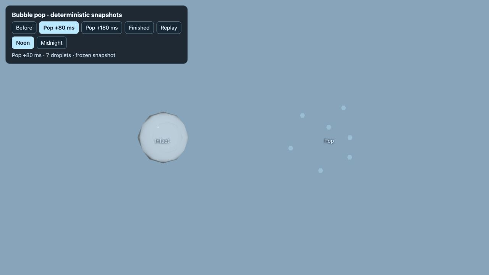
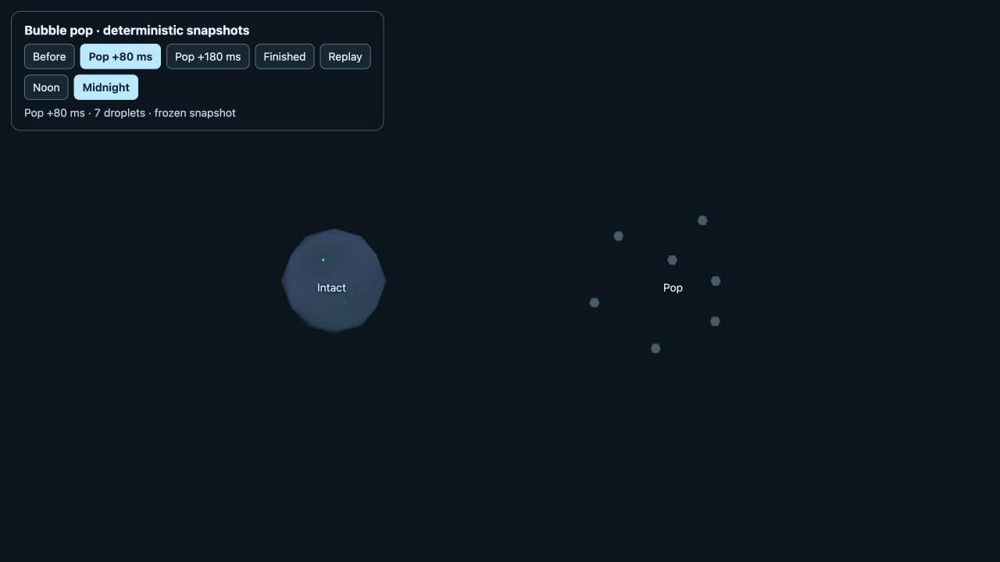

# Bubble pop verification, 2026-10-14

The sphere disappears on its pop frame. Seven small translucent droplets start on its surface, travel outward by about 10–16 cm, and fade in size within 0.25 seconds. One instanced mesh reuses 128 slots, adds no shadow casters, and hides when empty.

- `node bin/test-bubble-pop`: instant removal, full-sphere directions, shell origins, outward travel, pool saturation/reuse, expiry and accurate ground-pop counts.
- `node bin/test-bubbles-visibility`: empty/renderable state transitions still pass with droplets as a child of the existing bubble mesh.
- `npm run check` passed with the pop test included.
- The actual Three.js preview was inspected at Noon and Midnight using the frozen +80 ms view. The images are enlarged inspection views; gameplay bubbles and droplets are much smaller on screen.

Open `verification/bubble-pop/check.html?mute=1` for Before, +80 ms, +180 ms, Finished and Replay controls.

