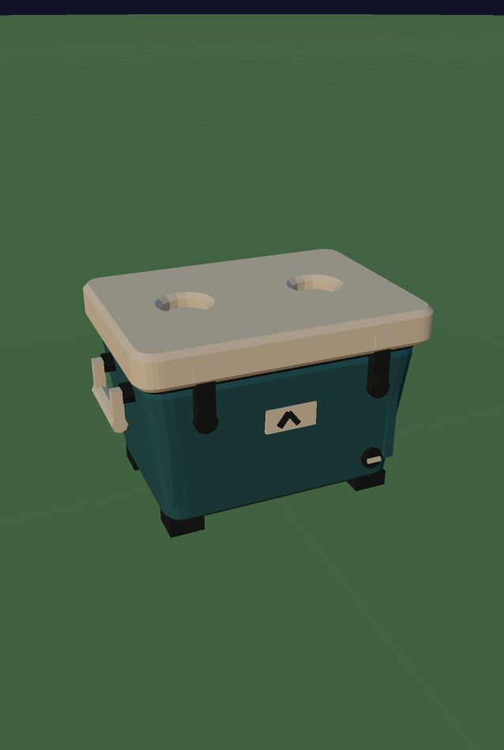
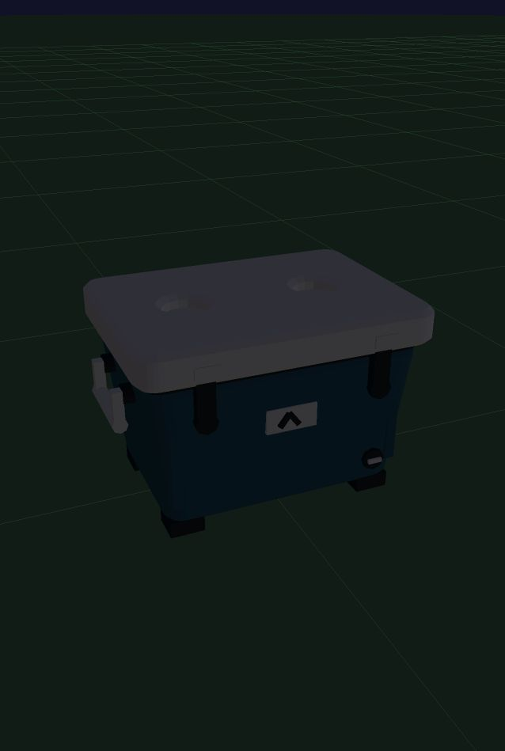
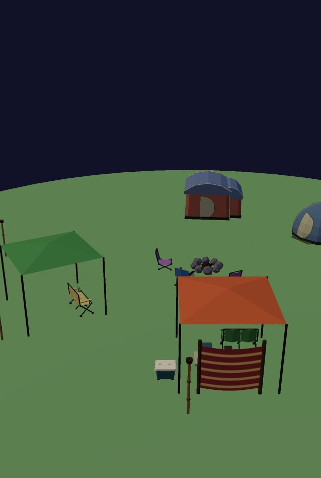

# Camp coolers, October 29, 2026

Campsite kitchens use `buildCampCooler()` in `src/models/campsite.js`.
The refined model has a lower tapered shell, rounded molded corners, a beveled
cream lid with two cup wells, continuous side handles, front latch catches,
rear hinges, rubber feet, a drain cap and a small mountain badge.
Kitchen-bearing camps get one cooler at local `(1.9, 0, -0.7)`; light-traveler
and satellite pitches continue to omit kitchens. This is scenery with the
existing `camp_cooler` collision, rather than a pickup or storage interaction.

The four body finishes derive from an already sampled camp angle, without
consuming caller or layout randomness. The complete model still fits the
existing `.42` collision radius. Three lazily built material geometries and
six materials are shared across instances, with the shared-resource disposal
flag. Temporary construction geometries are disposed after merging.

## Measured geometry cost

The prior cup-holder model in commit `a64d63a` used three draws and 320
triangles. The refinement uses three draws and 1,460 triangles, adding 1,140
triangles and one pooled geometry while retaining zero shadow casters, lights
and textures. The isolated sandbox including ground/helpers goes from five
draws and 368 triangles to five draws and 1,508 triangles. This is a topology
comparison, not a device frame-time measurement.

## Checks

- `node bin/test-camp-cooler`: 40 native Three.js builds cover all four
  deterministic finishes, grounded feet, every vertex within the collision
  radius, shared resources and a 1,500-triangle ceiling. Horizontal raycasts
  verify the tapered body. Downward raycasts verify both cup floors at `.415`,
  below the `.445` lid top, and sixteen rim samples reject a closing-seam spike.
  The production kitchen builder installs the cooler at its reserved location.
- `npm run check` and `npm run build` passed after the final geometry change.
  The suite includes 1,800 camp layouts, neighborhood/door/chair approaches,
  registry ownership and woodland integration. Existing Node module-type
  warnings and the build chunk-size advisory remain.
- In-app sandbox: inspected the refined model at Noon and Midnight using
  `perf=low&mute=1`, then inspected it beside the complete family-base kitchen.
  The entity sandbox retains Standard materials even with Low requested;
  the real game smoke test covers the Low-tier Lambert path.
- Chrome: clicked the ready Just Cruisin' plank at `/?perf=low&mute=1`, observed
  the running landscape world and HUD, and found no console errors. Test tabs
  were closed afterward; the existing development server was reused.
- These checks establish desktop rendering and integration, not phone FPS or
  audible collision-sound acceptance. The existing sound mapping is unchanged.

## Captures

Open `/sandbox.html?entity=camp_cooler&mute=1` for the isolated model or
`/sandbox.html?entity=campsite_family-base&mute=1` for its kitchen context.
The browser viewport changed during the session, so these captures illustrate
appearance rather than providing a pixel-aligned comparison.

