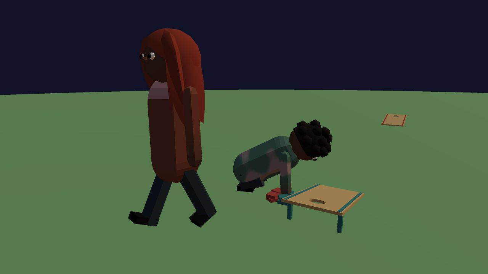
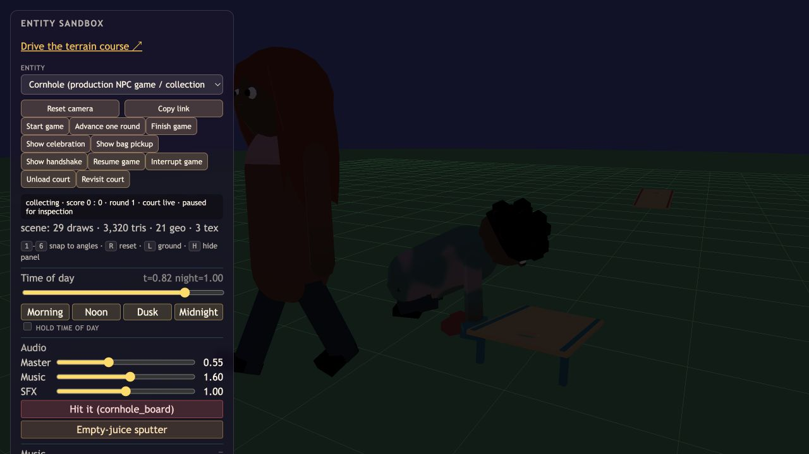

# Cornhole pickup stoop

November 16, 2026.

The reported backward lean was the bag-collection pose, not an idle animation.
It used a positive X rotation around the feet, tipping the entire figure away
from the bag. The replacement uses a forward hip hinge, an eased knee bend and
a lower pelvis while both soles stay planted. Ground bags require a deeper
stoop than bags resting on the board. The collector faces the actual bag and
lifts it with the hand as they stand, rather than having it appear in hand at
the start of the reach. The loser reaction also slumps forward without tipping
the whole body.

## Reproduction and inspection

Open `/sandbox.html?entity=cornhole_activity&perf=low&mute=1` and select
**Show bag pickup**. It advances the real session to a reach, pauses, and frames
the collector. Noon and Midnight allow close inspection; **Resume game** or
**Advance one round** continues from the inspection. The sandbox and real game
use the same Crowd rig, activity claims and CornholeSession choreography.

## Regression coverage

`npm run check` and `npm run build` passed.

`bin/test-cornhole-activity` uses the production Crowd matrix publisher and the
same CPU leg solve as the shader. It verifies planted world-space soles through
the complete stoop, lowering hips, forward knee flexion, head movement and
hand-to-bag distance under 0.11 times person scale. Ground and deck-height bags
are checked from both sides of a rotated court. The seeded game completes
12 rounds in 1,015.1 simulated seconds, with cleanup and normal walking restored.
Existing hoop, photographer, chair and shared-motion checks cover other users
of the planted-foot rig. No geometry or shadow casters were added.

## Browser checks

The muted production-NPC sandbox was inspected on Low at Noon and Midnight,
and on Mid at Noon. Its paused pickup view showed the crouch and hand reach,
and the live game sequence reached a 12-round, 11–24 handshake before tidying
and returning to idle. [Handshake state](handshake-state.txt) and
[completed state](completed-state.txt) retain the visible results. The scene
remained 29 draws and 3,320 triangles in the full inspection view, matching the
existing two-person fixture. Console warning/error inspection was empty. The real Low game also booted through the ready Just Cruisin’ title button, streamed its world and reported no console warnings or errors. [Game console](game-console.json).

## Limits

This remains stylized procedural animation, with straight arm segments and a
shared two-segment leg solve. The captures establish desktop appearance rather
than physical-device readability, audio or frame-time performance.
