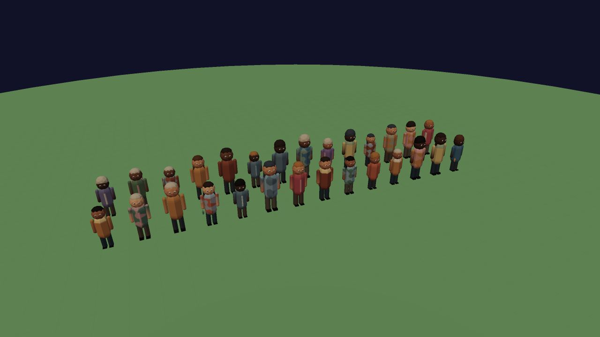
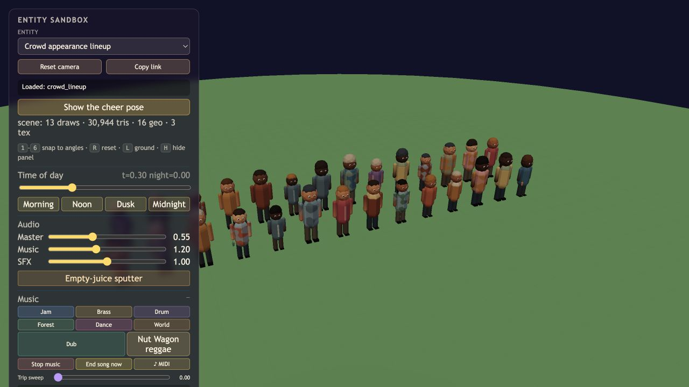

# Crowd appearance verification, 2026-10-14

The ordinary crowd now selects skin tone, hair, clothing and an optional beverage from an independent seeded appearance stream. Gameplay RNG consumption is retained. Six skin tones, three hairstyle silhouettes, six hair colors, twelve shirt colors and four color treatments expand the existing stylized model. Cups occur at 7% probability (6.6% in the 12,000-position test sample).

## Evidence

- `npm run check` passed, including the appearance and photographer regressions, importmaps and worldgen checks.
- [Browser lifecycle results](results.json) use the production Crowd constructor: 28 people, three cups, slot reclamation, seated/cheering attachments and camera-pose hiding.
- The browser harness also asserts white base materials, so the skin and pants palettes are not multiplied by old fixed colors.
- Low and mid sandbox materials compiled without warnings or errors. The muted main game started through its title button on both tiers at seed 932033385, without browser warnings or errors. These are startup checks, not extended playtests.
- The lineup submits 13 draws and 30,944 triangles including its ground. Hair and cups add four instanced batches and no shadow casters. Compact ordinary and hairstyle slots avoid submitting the full pool for a small crowd. This is an isolated fixture, not a full-game performance benchmark.
- The lineup cheer preview now uploads changed instance matrices, including the final return to the resting pose.

## Reproduce

Open `sandbox.html?entity=crowd_lineup&perf=mid&mute=1` or use `perf=low`. Choose Noon or Midnight; use the cheer button to inspect cup attachment. Open `verification/crowd-appearance/check.html?mute=1` for the production geometry and lifecycle assertions.

The cups are ambient props. Food-truck purchasing and dining remain a separate roadmap behavior.
