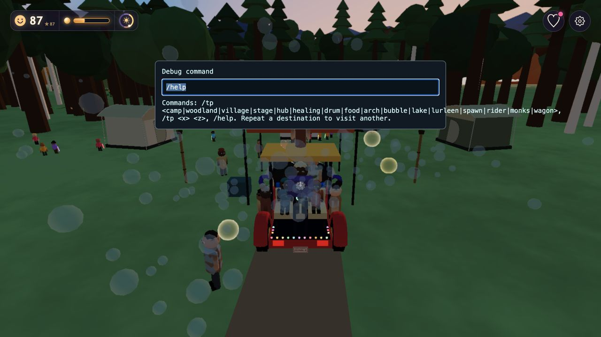
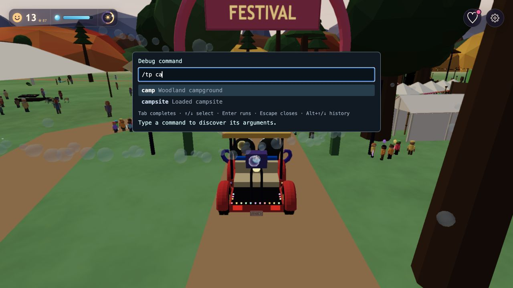

# Debug command prompt and teleport itineraries

October 23, 2026. No commit or deployment was performed.

[Debug implementation](../../src/debug.js) shares one seed-scoped itinerary between the Go button, `window.__debug.locate(kind)` and `/tp`. Repeating a category within 30m of its arrival excludes visited matches; exhausting a bounded search wraps while preferring a destination other than the arrival. Driving away or changing seed resets nearest-first selection. Singleton destinations stay usable. Dynamic actor and loaded-registry destinations retain their existing availability limits.

Press `/` outside editable fields for the command prompt. Contextual suggestions expose command names and the valid destination arguments, with case-insensitive prefix filtering and descriptions. Tab or click completes an argument, Up/Down selects one, and Enter accepts a selected suggestion or executes when none is selected. Alt+Up/Down retains command history. The input uses combobox/listbox semantics with an active-descendant selection. It supports destination aliases, finite numeric coordinates, `/help`, 30-command Up/Down history and Escape dismissal. Commands use an allowlist with text output rather than JavaScript evaluation. [Input handling](../../src/input.js) clears held keys and pending edges on editable-field focus, while the prompt prevents command keystrokes from reaching gameplay/debug handlers.

`bin/test-debug-teleports` covers five destination families, distinct visits before wrapping, no immediate wrap repeat, seed and drive-away resets, missing/singleton destinations, retained height/stopped motion and command parsing. The full `npm run check` passed; [saved output](checks.log) records the scope.

A muted Low-tier seed-1977 game was started through the ready Just Cruisin' button. Two `/tp camp` submissions produced (-64,-285), then (312,-285). Selecting Woodland campground and clicking Go advanced to (95,-650), then another Go reached (134,-861). `/help` rendered correctly, Escape dismissed the prompt and command typing did not open the Trip/debug panels. No console warnings/errors were reported. The temporary game tab was closed and Gary's existing server was left running.

## Autocomplete verification

The extended focused test covers command and argument discovery, case/prefix filtering, exact arguments, coordinate input and replacement at the caret. In the real muted game, `/t` followed by Tab became `/tp ` and exposed 17 destination aliases, while `/tp ca` filtered to camp/campsite. Down then Enter completed camp, and the next Enter teleported successfully. The full check suite passed after these changes. Console inspection reported no warnings/errors, and the owned game tab was closed.

