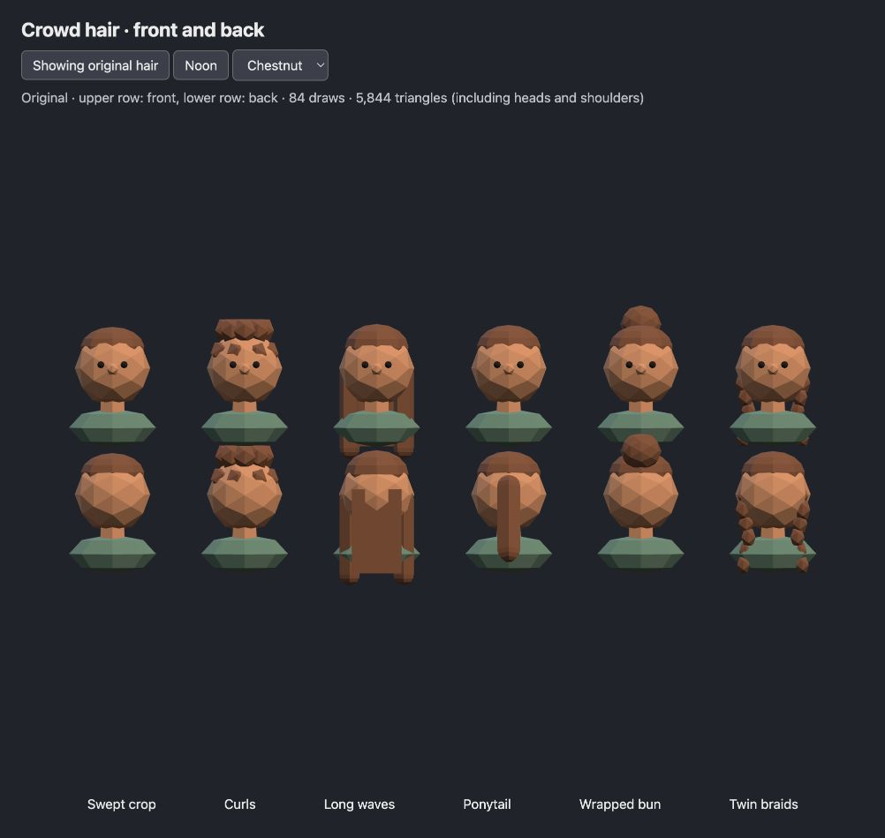
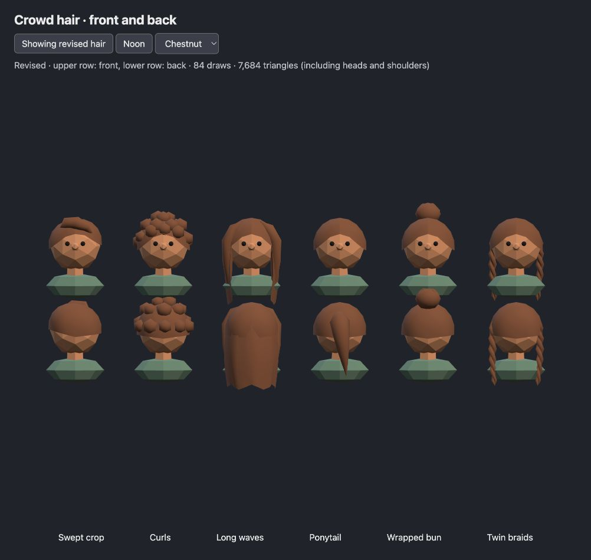
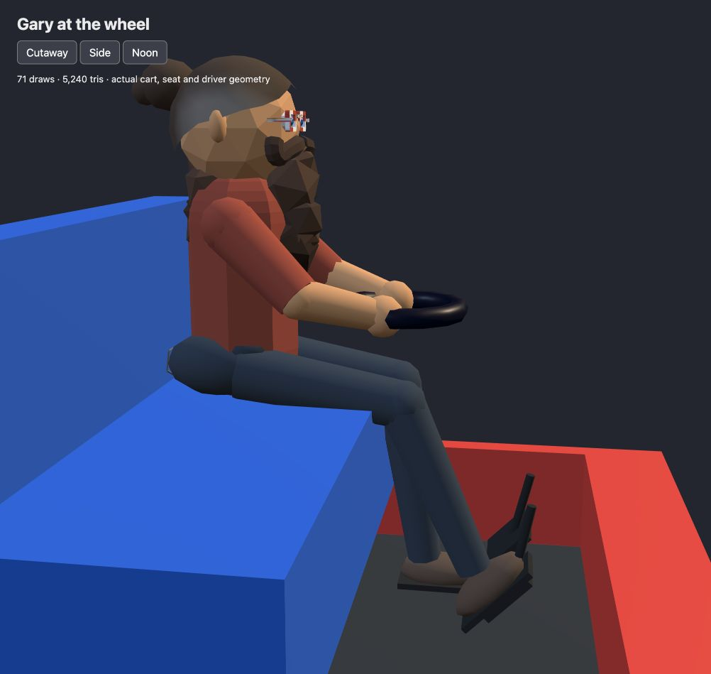

# Hair across festival people and Gary’s driving pose, October 30, 2026

The six production Crowd styles now use skull-following hairlines, a swept crop,
continuous curl coverage, a folded long-hair curtain, a tapered curved ponytail,
a wrapped bun and two woven braids. Hair uses smooth normals with the existing
opaque rough material. Appearance RNG, colors, style selection, instance slots,
head transforms and shadow flags are unchanged.

## Visual comparison

Open `/verification/hair/index.html?mute=1` on the local Vite server. The button
switches between the frozen original geometry in `baseline.js` and the actual
`src/crowdHair.js` builder. Both use the production head dimensions and hair
transforms, with identical chestnut coloring for easier comparison. The original
uses flat shading and the revision uses smooth shading, as in production.
This small comparison renders only on interaction or resize, with no animation loop.
Its lighting presets are illustrative; the production sandbox captures below use
the real time-of-day system. The comparison is a development fixture, not a Vite
production entry page.

| Before, noon | After, noon |
| --- | --- |
|  |  |

[Comparison at night](after-midnight.png), [production sandbox at Noon](sandbox-noon.png),
[production sandbox at Midnight](sandbox-midnight.png), [live Low-tier game](game-low.png).

## Geometry cost

Counts come from actual Three.js position/index buffers, not primitive stubs.
`baseline.json` records the original construction before replacement, and
`node bin/test-crowd-appearance.js` prints the revised counts.

| Style | Original triangles | Revised triangles |
| --- | ---: | ---: |
| Cropped | 116 | 208 |
| Curls | 320 | 640 |
| Long | 264 | 440 |
| Ponytail | 206 | 256 |
| Bun | 196 | 290 |
| Braids | 356 | 544 |
| Two instances of every style | 2,916 | 4,756 |

The comparison scene reports 84 draws for both versions, with 5,844 original
versus 7,684 revised triangles including heads and shoulders. The production
`crowd_hair` sandbox reports **15 draws, 15,460 triangles, 19 geometries and 3
textures** at both Noon and Midnight. The hair remains six instanced buckets
and adds no shadow casters. These are geometry/draw counts, not an FPS claim.
The builder allocates once per Crowd owner, with no added per-frame hair work;
allocation timing and physical-device performance were not benchmarked.

## Every human family

The shared builder in [crowdHair.js](../../src/crowdHair.js) also supplies
head-sized geometry to children, frisbee players, hoopers, dancers, drummers,
monks, paddlers, yoga participants, one-wheel riders, Bo, performers and bands.
The default hair in [puppet.js](../../src/models/puppet.js) covers vendors,
parade carriers and the marshal; Sugar Shack cooks and Tom use fitted styles.
Wooks retain their dreadlock silhouette with tapered locks. Gary has a custom
reference-based swept scalp and bun in [garyDriver.js](../../src/models/garyDriver.js).

Open [the family viewer](families.html?mute=1) to inspect 25 portraits from the
real constructors, including front/back and day/night controls. The
[person test](../../bin/test-person-hair.js) builds 63 models across 21 family
paths, tests shared ownership and finite geometry, checks scalp coverage and
compares RNG consumption with [the frozen baseline](rng-baseline.json).
Baked specialist meshes retain their batching, while individual hair meshes
use shared resources and do not cast additional shadows. These model-specific
changes do not imply a fixed draw count across all characters.

## Gary and the cart

[The driver viewer](driver.html?mute=1) uses the actual cart geometry, with
cutaway/full-cart, side/front/back and Noon/Midnight controls. Gary has a taller,
narrower torso, rounded seated jeans, subtle rear seams and long bent legs.
His right shoe meets the angled accelerator, with a wider suspended brake
beside it. The recessed footwell has a dark gray liner. Hair follows the supplied
photos: swept brown hair, gray temples, a receding forehead and a rear bun.

[Midnight capture](gary-midnight.png). The cutaway reports 71 draws and 5,240
triangles including the driver, visible chassis and bench. This is a fixture
count, not a whole-game performance claim. Contact tests verify the sole/pedal
plane, seat height, structural floor clearance and head proportions.

## Verification and limits

- The crowd appearance and person hair tests pass, covering deterministic
  geometry, RNG, palettes, pooling, eye clearance and style triangle limits.
- The complete hair-only change passes `npm run check` in an isolated HEAD
  snapshot, excluding concurrent hoop edits. The final working tree also passes
  the full suite after the last driver adjustments. See [final check output](check.log).
- `npm run build` passes with the existing bundle-size warning.
- The production crowd sandbox was inspected at Noon and Midnight. The real
  Low-tier game was started through the ready **Just Cruisin’** button after
  the final driver edits, and console inspection found no errors.
- Browser evidence is from desktop; physical-device speed and iOS audio unlock
  were not tested. There is no added per-frame hair animation or allocation.
- The existing Vite server was reused and temporary test tabs were closed.
  No standalone browser process or development server was started.
