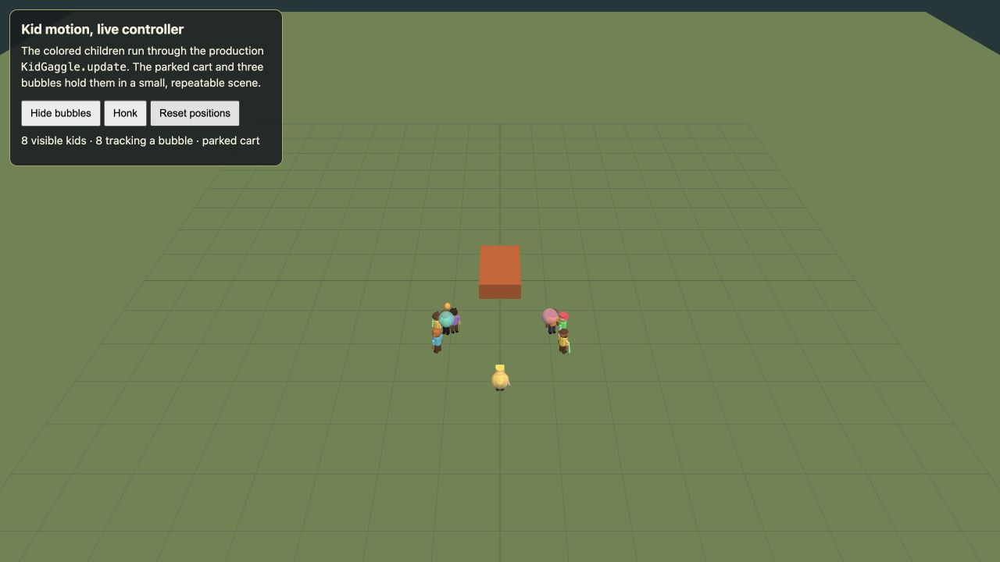

# Kid motion verification

Run `node bin/test-kid-motion` for the controller regression checks. They exercise the production `KidGaggle.update` method with a stationary bubble, competing bubbles, a stationary cart, center steering, target loss, angle wrap, and 30/60/120 fps movement. `node bin/test-kid-bubble-query` checks that the bubble scan still preserves smile scoring and animation results.

For a live visual check, start `python3 .Codex/serve_nocache.py 8765` and open `http://127.0.0.1:8765/verification/kid-motion/index.html?mute=1`. The page constructs the production `KidGaggle`, shows eight children near a stationary cart, and supplies three bubbles whose positions shift slightly. **Hide bubbles** checks the transition back to wandering, **Honk** checks the flee and return transition, and **Reset positions** repeats the setup. `window.__kidMotion` exposes the controller and scene for inspection.

The expected motion is a continuous run toward a chosen bubble, a stop at arm's reach without stepping through it, stable targeting when nearby bubbles trade nearest position, and a return to ordinary 3–5 m/s wandering after the bubbles disappear. The bubble sprint remains 4.2 m/s, while the adult crowd's normal movement paths use 1.1–2.4 m/s times energy in `src/crowd.js`.

Verified on 2026-10-14: the full `npm run check` suite passed, including both kid tests. The in-app live preview showed eight children tracking bubbles, then zero tracking after Hide bubbles, with no warnings or errors. The main game booted on low and mid tiers with `mute=1` and no warnings or errors. This is a focused controller/startup check, not a long drive test.

