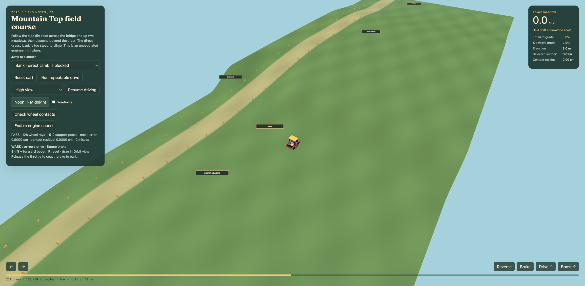

# Landscape engineering proof

November 1, 2026. [Execution front door](../../openspec/changes/landscape-and-travel/README.md) · [Full design and Mountain Top reference](../../docs/backlog/landscape-and-travel.md).

**TL/DR:** The authored two-shelf/side-road/bridge proof now runs through the existing terrain sandbox and real Zerble controller. Shared support selection keeps bridge and riverbed separate at the same coordinates. This is an unpopulated bounded fixture, not procedural mountains, a complete stream system or public gameplay rollout.

## Inspect it

Run `npm run dev`, then open `/terrain-sandbox.html?surface=landscape&mute=1` on that server (default port 8765; the `./start` launcher uses 8747). Existing authored and `surface=world` modes remain available. The section picker includes both meadows, the foot of the steep bank, side climb, clearing, bridge deck and riverbed beneath it. Noon/Midnight, wireframe, high/orbit views and the existing contact check remain usable. The selected-support readout distinguishes terrain from the bridge.

The repeatable drive follows the side road at x=-40. It crosses the cut channel, climbs past the direct bank and descends into the clearing. The bank jump is placed on legal ground at its foot, so the cart can approach it and reverse away. The underneath jump is a support-selection inspection fixture, not a claim that driving underwater belongs in the game.

## Code and measurement

- [Support service](../../src/landscape/support.js): immutable bounded descriptors, separate observations/proposals/accepted commits, explicit approach transfers, blocked closed/missing supports, independent bindings, wheel contact guards and validated vertical intervals. Interval logic is pure; live contact publication is still future work.
- [Authored fixture](../../src/landscape/fixture.js): 8-meter lower meadow, 18-meter upper meadow, 14-meter clearing, direct steep bank and longer side climb. Terrain and rendered buffers share one-meter triangles; channel bed is -3m, water -2.5m and deck 0m. These are engineering defaults, not measured real-property dimensions.
- [Controller hook](../../src/terrainDriving.js): opt-in bindings propose/commit only accepted movement; ordinary game carts retain their current sampler behavior. Whole-cart corridor/turn/relocation enforcement remains a later task; wheel guards are not that complete system.
- [Sandbox](../../src/terrainSandbox.js): shared mesh buffers, explicit layer-selected rays, support save/restore after verification and the production cart.

| Check | Result |
| --- | --- |
| `node bin/test-landscape-support` | Pass: no support mutation during probes/proposals, bidirectional approach entry/exit, underneath actor separation, closed/missing support, rejected contact footprint, immutable descriptors, stable candidate order, finite inputs and vertical-solid intervals. |
| `node bin/test-landscape-fixture` | Pass: exact shared triangle interpolation and strip seams, bounded inventory, meadow/clearing heights, bank/side-road contrast, selected terrain/deck rays and real controller tests. Only canvas painting/event registration are stubbed; geometry, cart update and suspension are actual production code. |
| Actual cart calls at 30/60/120Hz | All finish at z=-401.0003835310532 after 24 seconds; maximum wheel residual under 1.31e-8m on the tested route. Both travel directions cross the bridge. Boost cannot cross the direct bank and reverse escapes it. These route fixtures do not establish every diagonal/relocation/turn case. |
| Mesh inventory | 55,781 allocated terrain vertices (55,176 unique), 109,200 terrain triangles, six strips; one 2-triangle deck and one 2-triangle water surface. |
| Real Chrome Low and Mid contact button | Both pass 128 wheel rays and 512 support poses with zero misses; displayed mesh/contact error rounds to 0.0000cm. Expected mesh is selected by support geometry identity, so riverbed rays cannot accidentally certify the deck. |
| Same X/Z bridge jumps | Deck readout 0m / `fixture:side-road-bridge`; underneath readout -3m / `terrain`. |
| Initial chase-view counters | Earlier authored Low course: 255 draws / 141,611 triangles. Landscape Low/Mid start: 259 / 141,619. The +4/+8 difference includes two extra labels and the deck/water surfaces. Later views differ with culling. Both baseline and proof exceed the historical Low draw guide; the measured delta does not establish acceptable phone performance. |
| Construction readout | Earlier authored in-app Low: 32ms; landscape Chrome Low: 39ms, Mid: 27ms. Different browser runs and no repeated timing sample, so these are observations, not a comparable performance claim. |
| Full checks/build | `npm run check` and `npm run build` pass. Existing large experimental Rapier chunk and Node module-type warnings remain. Focused tests also passed after adding return-direction/footprint regressions. |
| Real game integration smoke | Chrome Low: ready Just Cruisin' mode-plank click, title exits, live HUD/world runs, console error/warning query empty. This protects current gameplay, not new district integration or iOS audio unlock. |

## Captures

[Noon, Low](2026-11-01-noon-low.png) · [Midnight, Low](2026-11-01-midnight-low.png) · [Bridge inspection, Low](2026-11-01-bridge-low.png) · [Real-game smoke, Low](2026-11-01-game-low.png).

## Browser/process limitations

The first in-app render exposed a typed-index wiring error, which was corrected to use BufferAttribute. Subsequent in-app reload/acquisition failed through its focus-control channel. The prior server on 8747 was also no longer listening; that is a separate observed fact, not a proven explanation for every browser timeout. A temporary loopback Vite server on 8765 supplied successful real-Chrome verification. No standalone headless browser or development server was started before that replacement server.

The owned Chrome test tab was explicitly closed and its ID confirmed absent. The in-app tab (ID 1, provider browser-use:c20db478-c77c-4be8-a5da-c3d29e44e05d) could not be reacquired to close through the documented control API, and native control of the Codex app was denied. It is unmarked and subject to automatic end-of-turn cleanup, but explicit removal has not been observed. No unrelated process was killed. A compact CPU query showed no runaway in-app workers at inspection time, not a general process all-clear. The temporary owned Vite server was stopped with Ctrl+C; its execution session exited with code 130. No task-owned development server remains running.

## Remaining acceptance

Complete explicit browser cleanup confirmation and finalize Task 3.4 (proof verification). Then proceed to Group 4 (authoritative travel): full-width routes and switchbacks, all position corrections and actual vertical collision publication. Populated districts, bounded procedural admission, source-to-receiver streams, props/actors/navigation, streaming ownership, real-phone evidence and rollout remain unchecked. The Barn and first-aid booth/tent stay future work.

## Subsequent cleanup confirmation

On resuming implementation, browser inventory contained neither the failed in-app tab nor any prior localhost Chrome tab. Automatic cleanup therefore completed, closing the earlier explicit-removal uncertainty. The temporary server had already exited. Task 3.4 (proof verification and cleanup) is now complete.
