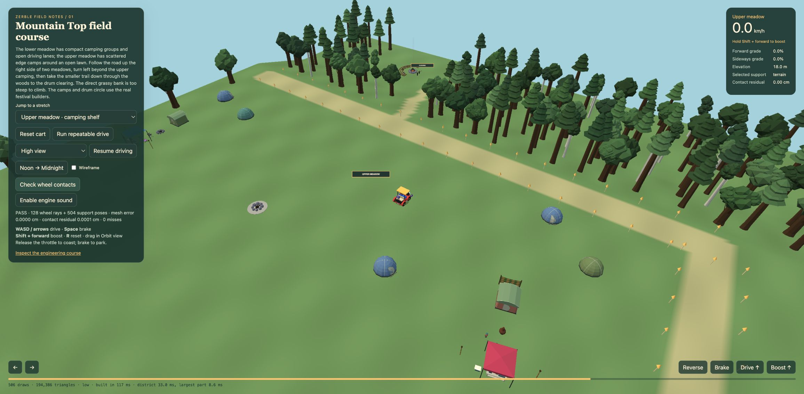

# Landscape and Mountain Top verification

November 1, 2026. [Execution status](../../openspec/changes/landscape-and-travel/README.md) · [Design and historical photographs](../../docs/backlog/landscape-and-travel.md) · [Initial unpopulated proof](2026-11-01-initial-proof.md).

**TL/DR:** The opt-in generation-2 game now streams varied Mountain Top districts with real camps, people, fires, wooded trails, streams and bridges. Vehicles, people and activity eligibility use shared support; physical props can attach through the existing engine adapter. Performance measurement, physical-device acceptance and player recognition still gate rollout, and generation 1 remains the default.

## Inspect the current proof

Run `npm run dev`, then open `/terrain-sandbox.html?surface=landscape&district=1&mute=1&perf=low`. Omit `district=1` for the unpopulated geometry course; existing authored/world modes remain available. The populated **Run repeatable drive** follows ordinary controls to the wooded clearing and returns over the bridge without teleporting. Pause, Noon/Midnight, High view, Look downhill, selected-support diagnostics and the contact button expose the same runtime. Golden flags, signs and simplified ground shading are inspection aids, not proposed festival furnishings.

The current fixture is version 4: 240m wide, 455m long, with a 2m X / 1m Z exact-triangle lattice. The lower meadow is at 8m, the upper meadow at 18m and the separate wooded drum clearing at 10m. A right-side road turns left beyond the upper meadow before a smaller wooded descent. The lower meadow has eleven compact irregular pitches, while the upper meadow has seven scattered pitches around an open lawn and a separate communal firepit. Seeded packing has finite candidate/minimum-capacity limits and actual built-prop clearance checks. The historical sculpture is reference only.

## Executable checks

| Check | Observed result |
| --- | --- |
| `node bin/test-landscape-support` | Pure layer selection, approach transfer, nonmutating queries, immutable descriptors, blocked missing/closed supports and vertical interval rules. |
| `node bin/test-landscape-fixture` | Exact mesh/triangle agreement and strip seams; 55,781 allocated terrain vertices, 109,200 triangles, six strips, two deck triangles and two water triangles. Actual 30/60/120Hz cart calls finish at z=-402.0354404715924 with maximum contact residual 2.14e-7m. Both directions cross the bridge. |
| `node bin/test-landscape-travel` | Full-width route/end/join/turn checks, finite alternatives/work, intermediate translation/rotation collision guards, rejected unsafe relocation, boost/diagonal/reverse recovery, real registry and live pooled vertical metadata, separated below-deck solids and spanning hits. The 346m side ascent reaches the top turn with maximum grade 17.14% and zero crossfall. |
| `node bin/test-landscape-district` | Production camps and seated/animated drum crew/fire; actual control out-and-back through solid collisions and the winding trail; visitor bridge/ascent travel; camp claim grounding; rejected unreachable boarding; real passenger drop-off on the upper shelf; counted pins, duplicate-owner rejection, four build/dispose cycles, obstruction and partial-build rollback. |
| Local route measurements | Main road: 530m, maximum 17.14% grade, zero crossfall. Wooded trail: 62.52m, maximum 26.51% grade and 11.93% crossfall. Full drive to the clearing: 516.52m. Main roads retain a 20% grade ceiling; this separately declared secondary trail allows 30%. |
| Current full check/build | `npm run check` and `npm run build` pass. Existing Node module-type and experimental Rapier large-chunk warnings remain. The existing passenger characterization retains 240 exact frames and random draw counts. |
| Low and Mid selected-layer browser check | Version 4 passes 128 rays and 504 support poses, with zero misses; displayed mesh error 0.0000cm and contact residual 0.0001cm. |

Tests use production geometry/controllers/builders/registry/Crowd, with DOM canvas/event stubs only where Node requires them. Their deterministic results do not establish phone performance or the correctness of every production mover.

## Performance and rendering limits

The populated district allocates synchronously in the workshop, rather than claiming to meet a streaming deadline. A Node four-cycle run measured 46.9ms cold allocation / 13.9ms largest builder, followed by 15.3–25.4ms allocation / 4.8–5.6ms largest builder. A built-preview Chrome Low start reported 117ms total course allocation, 33.0ms district allocation and 8.6ms largest component. A separate contended development load reported 724ms total / 201ms district / 87.3ms largest part. These are recorded observations, not comparable device benchmarks or proof that streaming work is within budget.

In the version-4 Low upper high view, the workshop reported 505 draws / 191,698 triangles before the final marker/camera refinements; moving built-preview views differ with culling. The earlier fifteen full camps reported 763 draws / 177,834 triangles in the upper view, while the replaced thirty-pitch host/satellite experiment reported 565 / 148,887. These intermediate layouts differ and are not an isolated performance experiment. Dense woods add real geometry. Staging, upload costs, production near/far agreement and tier/device acceptance remain gates before replication.

Gary reported blinking at both bridge approaches. Numeric inspection found terrain and deck both at exactly 0m at z=-74,-72,-28,-26, establishing coplanar overlap. The deck material now uses depth bias without changing support or mesh heights; the exact-triangle/rate tests still pass. The fixed-preview control replay completed the entire out-and-back route, and the bridge inspection capture shows the deck covering both approach overlaps without geometric displacement. Numeric contact acceptance remains a separate check.

## Browser verification and cleanup

The initial failed in-app tab was subsequently confirmed absent; the [initial report](2026-11-01-initial-proof.md) preserves that resolved history. During populated-proof work, development tabs became unresponsive to inspection after reloads. The task-owned tab IDs 380986743 and 380986779 were explicitly closed, and verification switched to a fixed production preview on loopback port 8766. This does not establish that Gary's interaction caused the problem. No standalone headless browser or unrelated process was killed.

The fixed-preview tab 380986789 completed the full ordinary-control out-and-back replay. Low and Mid both passed 128 rays / 504 support poses with zero misses and empty console warning/error queries. The real Low game at seed 1977 started through a ready Just Cruisin' mode plank, advanced to afternoon with 13 smiles and 55% juice, and reported no console warnings/errors. This protects the existing game path; it does not enable the authored district in public generation or establish iOS audio unlock.

The fixed-preview tab was explicitly closed and its server stopped (execution session exited 130). No standalone browser process was started. The task-owned development server remains running only while implementation continues.

## Current captures

[Low noon](mountain-top-low-noon.png) · [Low midnight](mountain-top-low-midnight.png) · [Mid noon](mountain-top-mid-noon.png) · [Mid midnight](mountain-top-mid-midnight.png) · [Upper-to-lower overlook](mountain-top-upper-overlook.png) · [Bridge approaches](bridge-approaches-low.png) · [Real-game smoke](populated-game-smoke-low.png). [Machine-readable measurements](district-results.json).

## Remaining acceptance

Desktop production integration now passes the scoped mover/activity/surface, streaming, map and ownership checks below. Physical iPhone/iPad driving and player recognition/route-choice playtests remain observed-human gates; use their results for final tuning and rollout. The Barn, first aid, car-camping vehicle models and mountaintop passenger quest remain future work.

## Procedural forms and finite admission

Generation 2 is explicitly selectable in the development map, while the game remains on version 1. Paired meadows, long ridges and three-shelf forms vary their heights, widths, road bends, occupation and optional landmarks on the native 10m triangle grid. Full terrain reservations suppress legacy occupied placement; bounded admission connects complete districts to actual surrounding arterials while protecting existing venue shapes, woodland pitches, lakes and foreign terrain influences. Complete owner bounds include the access spur, with a fixed 610m discovery halo.

`npm run test:landscape` includes the original proof plus form/candidate/population/admission/world-integration/worker tests. They cover native-grid rotations, negative coordinates, tiny windows, cache eviction, real context-order/epoch controls, protected-occupancy negative controls, exact version-1 restoration, production model publication and owned-worker termination. `npm run check` passed after these additions, and the production build includes a 66.33kB worker asset.

The [pre-stream survey](procedural-survey-before-streams.json) used seeds 1977, 42 and 2026, bounds [-3200,3200]², native 10m triangles and a finite 1200m regional road halo. It admitted respectively 5/6, 6/7 and 4/6 Mountain Top candidates, with no structural clones within any seed; all four rejections were finite `no-feasible-connection` outcomes. Admitted density was 0.098–0.146 per km². Every admitted district connects to its region's largest measured arterial component, with no unresolved anchors; this does not prove infinite-world connectivity. Connector detour was 1.00–1.26 times straight-line distance. Context took 61–752ms and admission 113–185ms in this Node run, so neither runs synchronously on the render thread. An owned worker has bounded pending/cache/jobs/time and rejects stale identities; transport failure is distinguished from canonical admission rejection.

The built map visibly reported two ready plans and no pending jobs at the inspected Mountain Top; its console warning/error query was empty. A subsequent Low game started through the ready mode plank and progressed to afternoon, 18 smiles and 50% juice, with no console warnings/errors. Tab 380986793 was explicitly closed and its preview server stopped. The [current map capture](procedural-map-v2.png) includes the finite water system and masks illustrative legacy density dots within planned meadows. This evidence does not claim production district streaming, physical-device performance or saved-map migration. Landscape version selection does not clear or rewrite progression storage.

## Complete finite stream and crossing proof

`/terrain-sandbox.html?surface=landscape&form=three-shelves&district=1&seed=1977&mute=1&perf=low` builds a generated populated district with a finite stream, separate receiving pond and wooden bridge. The other form names are `paired-meadows` and `long-ridge`. Sources descend from -0.5m to their own receiver levels (-0.674m to -0.704m in the three-family sample); they do not claim global mountain drainage or connections to unrelated lakes. Every complete water influence fits the reserved terrain core even if campsite admission rejects.

The [stream measurements](stream-results.json) record 356–400 clipped water triangles on the existing 10m terrain grid. Tests compare the rendered triangle interiors against the actual cut bed and matching water query, prove downstream flow after triangulation, reject floating/uncontained water, and require exactly level whole-cart bridge approaches. Real pedestrian support transfers cross the bridge while parallel ground movement stops at deep water. Dynamic support lookup refuses a removed occupied deck without falling back to terrain. Four owner rebuild/disposal cycles, shared-resource safety, counted pins and partial registration rollback pass.

The existing real Rapier adapter now accepts bounded copied fixed terrain triangles. A representative production cooler recipe settles on the bridge, while another at the same X/Z beneath the deck settles on the exact cut bed; water policy does not create a hidden physical floor. Mesh-index/type/capacity validation and complete engine teardown pass, and the prior physics adapter/runtime suites remain green. This is the small surface/prop proof, not a claim that all live physical props have migrated.

The production-preview generated course completed an ordinary-control full round trip with an empty warning/error query. The final populated Low and Mid course both passed 96 selected-layer rays / 448 support poses, zero misses, displayed mesh error 0.0000cm and contact residual 0.0056cm. The final Low build observed 209ms course / 37.2ms district / 8.3ms largest part; Mid observed 171ms / 24.5ms / 5.6ms. These synchronous workshop measurements do not satisfy a streaming-step budget. The bridge view observed about 294 draws / 129,064 triangles at Noon and 295 / 129,078 at Midnight, with view-dependent culling. No isolated steady-state performance gain is inferred.

The [current water-aware regional survey](procedural-survey.json) admitted respectively 4/6, 6/7 and 5/6 candidates for seeds 1977, 42 and 2026, again 15/19 total. Four finite access rejections remain, there are no structural clones within each seed, and all admitted anchors belong to the largest measured regional component. The larger complete terrain footprint changes some experimental candidate/road positions; current-version generation 1 fixtures still restore exactly. Node context measured 61–785ms and admission 167–242ms in this run, reinforcing the owned-worker requirement.

[Low Noon](generated-stream-low-noon.png) · [Low Midnight](generated-stream-low-midnight.png) · [Mid Noon](generated-stream-mid-noon.png) · [Mid Midnight](generated-stream-mid-midnight.png). Current game generation remains 1, and production streaming, all-consumer migration, mobile performance and player acceptance remain open.

## Staged construction groundwork

`bin/test-landscape-staging` exercises current-admission-only build jobs with bounded steps/deadlines, five cancellation depths, world-change cancellation, no partial scene/collider/light/audio publication, exact transferred seat/collider references and complete failure/owner cleanup. A separate Mid run covers actual context-light registration and removal. Existing synchronous campsite/drum callers consume the same resumable model sequence. [Original-model comparisons](staged-model-baseline.json) matched hierarchy/transforms, geometry/index/instance buffers, material values and RNG across 16 leaf seeds, eight complete crew seeds and eight campsite seeds across all three sizes; the prior approved height-injection difference is explicitly normalized. Repeated immutable crew geometry/materials are shared, while seeded skirt geometry remains private. The resource-only cleanup implementation now lives at `src/sceneResources.js` with its prior path re-exported, preserving the model/person authority boundary.

[Construction observations](staged-construction-results.json) distinguish total CPU from the largest step. The Node staged run used 463 steps and about 22–28ms total CPU, with observed 4.6–6.2ms drummer outliers; this does not establish a strict frame budget or an isolated performance gain. Cold context in this Node harness runs in the same process, unlike the browser's owned worker. The final Low/Mid workshop still passed 96 rays / 448 poses, zero misses and 0.0056cm contact residual, with empty warning/error queries. The real Low game started through its ready plank and ran to late night, 52 smiles and 0% juice, with no warnings/errors. Tab 380986820 was closed and preview session 34688 exited 130. Full check/build passed after the model-boundary correction. These checks preserve current behavior while the live landscape manager and dependent chunk/representation integration remain unfinished.

[Low crew Noon](staged-crew-low-noon.png) · [Low crew Midnight](staged-crew-low-midnight.png) · [Mid crew Noon](staged-crew-mid-noon.png) · [Mid crew Midnight](staged-crew-mid-midnight.png).

## November 1 player corrections and production manager checkpoint

The earlier hard vehicle-grade refusal is superseded by player feedback. The
landscape-only controller now accepts supported steep ground and integrates
bounded motor force, normal-load traction, gravity, momentum, resistance and
explicit braking. Pedestrian, road and campsite admission retain their stricter
limits. Water, closed bridge edges, bounds and removed supports still refuse
movement; generation 1 retains its existing controller.

`bin/test-landscape-driving` checks free downhill motion from rest at grades
0.6, 1.2, 2, 4 and 12 with three headings; moderate ascent, held-throttle rollback,
brake hold, water/bridge-edge refusals and actual 30/60/120Hz equivalence. At
140% grade, an 18m/s run-up climbs 13.685m horizontally before rollback, versus
4.074m from 8m/s. Actual cart plane contacts pass through 400% grade with diagonal
headings. All three generated families complete real-control return routes,
with route contact residual below 0.02m.

Generated lower/middle sleeping pitches now use a 10.5m center minimum instead
of the former 14m reservation-envelope separation, with more sleeping pitches,
fewer large hearth camps and lane-facing variation. All six real native-world
population fixtures build and dispose successfully, with 18, 36, 19, 42, 21 and
43 camps respectively; upper lawns remain sparse. These are generated plans,
not changes to the historical authored regression layout. Production furniture,
door, seat and road-clearance checks were not relaxed.

Low and Mid Chrome workshop checks both pass 96 selected-layer wheel rays and
484 poses, zero misses, zero reported mesh error and a 1.9700cm worst suspension
residual. Low's ordinary-control round trip also completes. The additional steep
poses make these counts distinct from the historical 448-pose result. Captures:
[dense lower Low Noon](dense-lower-low-noon.png),
[Low Midnight](dense-lower-low-midnight.png),
[Mid Noon](dense-lower-mid-noon.png), [Mid Midnight](dense-lower-mid-midnight.png).
Both workshop warning/error queries returned empty. The workshop still builds
its complete specimen synchronously, so its 214–240ms total setup and
45.6–65.4ms district setup are not runtime frame-budget measurements.

The new `LandscapeRuntime` owns the worker, canonical access index, finite
water/road owners, private staged districts, resident-only deck selection,
occupied-owner leases and unload/revisit cleanup. Dependent chunks wait for
complete access before placing their content. Runtime reservations affect only
runtime placement and distant rendering, never pure planning: regression checks
compare canonical region, nearest-road and terrain output with policy installed.
The opt-in `landscape=2` game boot dynamically imports the manager before mode
readiness and leaves the synchronous audio gesture unchanged. Version 1 stays
the default.

`bin/test-landscape-runtime` proves real worker-result adoption, staged model
publication, occupied bridge retention, complete unload/revisit with cached
canonical plans, resource/registry/worker cleanup, pending preparation
cancellation and policy revocation. It also checks owner-based shelter proxies
and woodland bins. Detailed camps yield to one pooled roof per actual built
shelter at 220m; woodland uses 80m bins and matching distant canopy proxies.
These detail thresholds remain tuning values rather than device acceptance.
Observed Node runs still contain 6–9ms individual construction steps and roughly
65–77ms total staged CPU, so the task budget is not a hard per-frame guarantee.

`bin/test-landscape-map` exercises the actual geography worker with generation
2: canonical access paths, finite stream/pond polygons, cleared meadow density,
bounded 256/512/1024m payloads and generation-1 restoration. Exploration uses a
separate `landscape-2` namespace, preserving the existing namespace. Cold
geography can take hundreds of milliseconds inside its owned worker; no cold
canonical admission runs on the renderer thread.

The full project check and build pass at this manager checkpoint. Production
mover/activity/physics migration, streaming performance/device acceptance and
final rollout remain pending. Gary's requested preview tab and preview server
remain available while he plays; agent-only verification tabs are cleaned up
when their bounded check ends.

## Vehicle integration checkpoint

`bin/test-landscape-vehicles` uses actual production controllers/models and a
real admitted native-grid candidate. The Nut Wagon and one-wheel rider each
cross and return on its selected bridge at actual 30/60/120Hz. A 45-second wagon
hill run rises 3.859m, with approximately 1.69e-14m measured wheel residual in
that declared run. Lurleen crosses the bridge and her controlled route-following
case reaches the upper meadow via the admitted side road in 27.783 seconds.
That test holds the following state to isolate route/controller capability;
ordinary encounter/forget-distance rules remain independently characterized.

The first rider attempt found an actual released wagon driver at the same
starting point and correctly yielded. The test now releases/removes its owned
people between independent cases. Existing pedestrian yield is unchanged, apart
from opt-in vertical eligibility for unrelated floors. Default vehicle and
terrain-mover characterizations pass, together with the full check and build.

The real Low game starts through its ready plank with `onewheel=1&nutwagon=1`
in the experimental world, reaches evening with 57 smiles, and displays the
actual one-wheel rider plus a cruising 7/9-occupied wagon with six riding monks.
Its warning/error query is empty. [Combined live capture](runtime-vehicles-low.png).
Agent tab 380986851 is closed; player tab 380986824 and preview port 8766 are
preserved while requested. People/activity/formation/bird migration remains
in progress, alongside the pending physics/performance/device work.

## People and physical-prop integration checkpoint

`bin/test-landscape-people` uses the actual pooled Crowd, independent children/wooks, both formations and birds. It proves selected-layer spawning, unreachable camp seats/beds/tables/hammocks, activity-ground checks, live vertical contacts, bounded swept walking, finite formation alternatives, cross-floor smile/offer eligibility and population cleanup. Existing default-generation behavior checks remain green. The Low production preview starts through a ready mode plank, displays the rider and boards six monks without warnings/errors; owned verification tab 380986882 is closed. This is a brief integration smoke test, not a long-duration memory or device measurement.

`LandscapeRuntime.attachPhysics(adapter, {origin})` connects an existing engine to native 80m terrain tiles and separate bridge slabs. Its `track(id, {radius})` requires a radius enclosing the complete prop; `step(delta, options)` prepares support before stepping and returns `stepped:false` when work or support is unavailable. A caller that owns its own stepping loop must instead require `prepare({delta}).ok` before advancing that engine. Both body poses and engine contacts use the provider's nearby coordinate origin through `toPhysics`/`toWorld`. There are at most 64 tracked props and 32 fixed surfaces by default, with four creates per preparation call and an explicit 2048m origin range. Recreate an empty provider around a new local region rather than silently moving occupied engine coordinates.

`bin/test-landscape-physics` runs actual cooler recipes above and below the same resident bridge, proves sleeping-owner retention and shared fixed geometry, preserves partial preparation over four one-create slices, refuses huge velocity and missing-owner cases, rolls back failed capacity admission and tests actual rotated contact corners near ±10 million world coordinates. `bin/test-landscape-runtime` also attaches a real engine, proves its prop retains the complete district/water after the player leaves, refuses occupied runtime teardown without revoking support, and returns engine/owner counts to baseline. The provider owns its fixed bodies and leases; the caller owns its dynamic-body identity and engine lifetime. Final shutdown explicitly removes tracked props, while ordinary disposal refuses them.

The separate physical-festival work still owns live chair/cooler controller activation, occupant reactions and its production clock. This change supplies its shared geometry/ownership boundary without claiming those pending features have shipped. The full project check and production build pass with the adapter included; its separate physical-festival fixtures also remain green.

## Integrated performance and desktop acceptance

The [four-cycle allocation probe](integrated-allocation-results.json), reproducible with `node bin/measure-landscape --out /tmp/landscape-allocation.json`, measures model allocation separately from a district-only pre-frustum scene census. For seed 1977 it observes 585 construction steps and 36 camps, 39.57ms cold total construction / 4.66ms largest step, then 13.45–18.74ms total / 1.52–1.66ms largest warm step. The near census is 307 potential draws / 62,204 triangles / 360,888 buffer bytes, while distant proxies are 16 / 1,040 / 37,464. Six hundred animation/visibility updates take 5.32–9.82ms total in Node. All four teardowns return scene and registry to baseline and verify 717 observed resources, including instance buffers and shared-resource non-disposal. These numbers exclude surrounding scenery, renderer culling, GPU upload and shadow passes.

A real-game Low observation exposed repeated construction of a distant halo candidate. The stationary reproduction retained that candidate at 32 steps every frame, because discovery admitted it beyond the unload distance. The access index now supplies cached complete owner bounds including road spurs, and loading/unloading use the same footprint with their distinct radii. `bin/test-landscape-runtime` includes a 60-frame no-allocation negative control for a distant candidate. Subsequent real-game observations settle at one completed owner and zero construction jobs; the [before/after notes](residency-fix-low.json) preserve the earlier timing state.

Phase instrumentation isolated a 21.2ms cold road-geometry step in the water owner. The worker now computes native non-indexed normals and UVs, whose normal arrays match Three.js within 1e-6. Validation uses finite typed buffers, exact attribute lengths and an unchanged combined 512,000-byte ceiling, including the transferred plan. The [19-candidate three-seed survey](render-buffer-survey.json) finds every expanded payload valid, with a maximum of 495,511 bytes. Subsequent browser water-owner maxima were 4.2ms Low and 0.3ms Mid/High, with different warm state, so no isolated speedup ratio is claimed. Browser model construction still has observed 2.2–6.0ms steps; there is no hard per-frame allocation-budget pass.

The [current tier snapshots](tier-observations.json) and [generation-1 baselines](baseline-observations.json) record the same initial seed/coordinates/heading, but the generated surroundings/populations differ and adaptive quality changes. Representative Noon snapshots are:

| Generation/tier | Active quality | Scene draws | Scene triangles |
| --- | --- | ---: | ---: |
| Generation 1 Low | baseline | 1,337 | 509,059 |
| Generation 2 Low | baseline | 959 | 329,489 |
| Generation 1 Mid | cheap-bubs | 1,739 | 916,700 |
| Generation 2 Mid | cheap-bubs | 1,132 | 567,973 |
| Generation 1 High | pixel-75 | 3,903 | 1,886,888 |
| Generation 2 High | cheap-bubs | 1,182 | 603,669 |

These are representative scene counts, not an isolated optimization experiment or a promise of device frame delivery. The old HUD draw budgets are exceeded by both layouts. Low uses Lambert materials and disables shadows; Mid/High use Standard materials and allow shadows. Active quality changes alter bubble cost significantly, and the saved moving snapshots include ordinary physical contacts. No general FPS gain is inferred. [Low Noon](final-low-noon.png), [Low Midnight](final-low-midnight.png), [Mid Noon](final-mid-noon.png), [Mid Midnight](final-mid-midnight.png), [High Noon](final-high-noon.png), [High Midnight](final-high-midnight.png), [first-person](final-first-person.png) and [top-down](final-top-camera.png) preserve the actual views; filenames refer to the chosen time preset, with simulation continuing afterward.

The [streaming/revisit observations](stream-revisit-observations.json) use visible support-aware `/tp` commands to travel to both ±5000-coordinate regions and return. The final view has the original district published, zero construction/planning/failures and no console warnings/errors. This is lifecycle coverage, while earlier controller proofs establish ordinary-control routes. Cold multi-kilometre debug jumps still show frame spikes, including a 162.5ms rolling maximum and existing chunk maxima around 30.8ms; this is not hitch-free travel evidence. The visible overlay/landmark teleports now share whole-footprint relocation instead of mutating a selected-support cart's coordinates directly.

Ready mode-plank boots, moving views, Noon/Midnight and all camera modes pass in real Chrome. Every disposable tab used here is explicitly closed, and the final inventory asserts all recorded owned IDs absent; baseline and final evidence reads close in `finally`. No headless browser was used. Gary's workshop tab and requested fixed preview server remain available on port 8766.

The final full check/build, focused physics/default-people suites and strict change validation are the engineering gate. Actual iPhone/iPad driving, readability and frame delivery, plus unprompted terrain recognition/route choice, remain unchecked and must inform final tuning. Generation 1 remains the default until those gates are observed.

## Player correction: boost and throttle release

Gary's report exposed a driving-feel regression that the earlier hill traversal tests did not cover. The [before/after controller measurements](boost-release-results.json) show one-second flat launch changing from 6.789m/s back to the original 18m/s; a half-second boost from 18m/s changing from 18.562m/s to 27m/s; and one-second release from 18m/s changing from 16.204m/s to the original 6.663m/s. Full torque now lasts until the selected speed target, shallow-ground grip preserves arcade acceleration, and release uses the original exponential drag. Gravity and lower steep-bank grip still govern climb/stall/rollback, with no supported downhill wall or parking hold. Releasing boost eases excess speed instead of instantly clamping it.

`bin/test-landscape-driving` checks flat launch/boost/coast at 30/60/120Hz, boost release and settling, slow-mode precedence, sputter suppression, reverse limits and the actual cart's `isBoosting` agreement with movement. The earlier downhill grades, momentum, bank rollback, brake hold, water/bounds/closed-deck refusals and all three real-cart round trips remain green. The retuned 1.4-grade uniform-bank run-up reaches 48.85m horizontally from 18m/s versus 9.69m from 8m/s, then rolls back under held throttle; these replace the older controller's run-up distances without rewriting its historical measurements. No physical-device feel acceptance is inferred.

The full project check and production build pass after this correction. A fresh Low real-game ready-plank boot accepts ordinary W and Shift+W, displays 24.04m/s after boost, and returns no warnings/errors. [Browser observations](boost-release-browser.json) include timing/contact limitations; the later stopped snapshot is not an isolated coast test. The owned verification tab is confirmed closed, and port 8766 serves the rebuilt fix.

## Main integration and seeded playtest corrections

[The November 1 integration report](2026-11-01-main-integration.md) supersedes the earlier checkpoint's statement that live physical-festival activation is still separate. It records the preserved `4521b19` checkpoint, integration of main `39e4797`, default live physics support above and below bridges, and both seed-3232217193 playtest fixes. Historical performance measurements above retain their original scope; they do not measure this combined branch or a physical phone.
