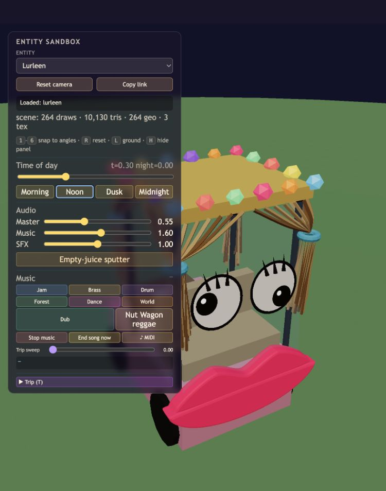
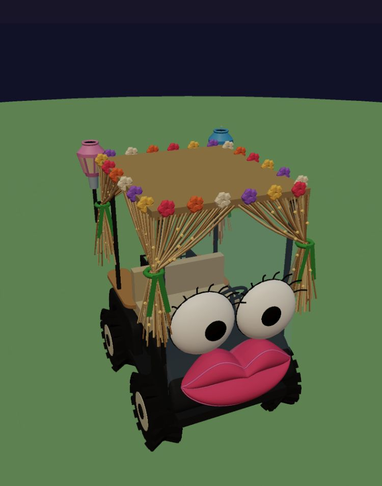
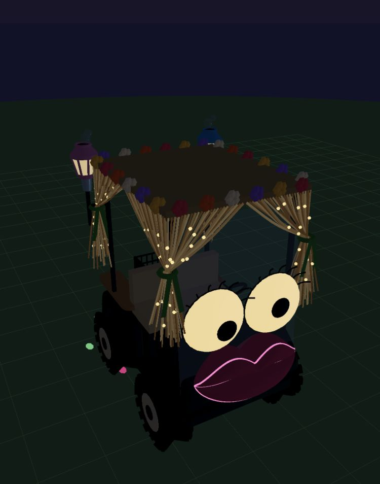

# Lurleen photo-reference model pass

Completed 2026-10-20. The three original Photos Library references and Gary's follow-up photos were inspected locally and were not copied into the repository. `ASTRA-BRIEF.md` is preserved as supplied.

## What changed

The curved front cowl, open footwell, rounded rear wheel arches, beige bench, cream wheel rims and tread, rounded eye domes, flower-trimmed gathered raffia and wooden rear platform replace the pink box body and flat face props. The driver's steering column is on the left. The rear side seats extend farther back and have rounded ends and beveled edges.

Gary's follow-up side view informed the lips' closed, rounded fabric cross-sections. Their material has zero emission at every time of day; only the separate pink cord glows. The 112 warm twinkle bulbs follow sampled raffia curves through both the gathered drapes and hanging bunches, with independent brightness phases. Dark eye backing prevents the illuminated fronts from shining through the rear.

The rear basket sits above a color-cycling disco lens with rotating colored ground spots. Blue and pink lantern-shaped bubble machines sit just above the rear roof corners, with warm inset panels and small reservoirs. They emit upward from their top openings into a fixed 24-bubble world-space pool. These are decorative bubbles and do not affect player juice, scoring or crowd attraction. The disco spots are a stylized ground effect, not shadow-casting projected lights. No new dynamic lights or shadow casters were added.

## Before and after

| View | Before | After |
| --- | --- | --- |
| Noon front three-quarter | [Before](before-noon-front.png) | [After](after-noon-front.png) |
| Midnight front three-quarter | [Before](before-midnight-front.png) | [After](after-midnight-front.png) |
| Noon rear | [Before](before-noon-rear.png) | [After](after-noon-rear.png) |
| Midnight rear | [Before](before-midnight-rear.png) | [After](after-midnight-rear.png) |
| Noon side, lip thickness and rear seats | | [After](after-noon-side.png) |

## Measurements

The frozen pre-change source in `baseline.js` comes from `src/lurleen.js` at commit `7d8378166dc0ade25bc10de9941f54b38f1b457b`, with only its relative imports redirected to `../../src/`. It is a verification fixture, not a production module.

`check.html?perf=low&baseline=1&mute=1` and the equivalent `perf=high` run instantiate both real models, advance each for 240 fixed 16 ms steps, and render at the same 640×480 size and camera. This fills the new decorative bubble pool. Both tiers returned identical model submissions:

| Metric | Before | After | Change |
| --- | ---: | ---: | ---: |
| Render calls | 262 | 86 | −176 (−67.2%) |
| Submitted triangles | 10,082 | 34,824 | +24,742 |
| Body mesh objects | 261 | 85 | −176 |
| Shadow casters | 7 | 7 | 0 |

Sources: [low results](low-results.json), [high results](high-results.json). These are model-only GPU submission counts with shadows disabled in the controlled renderer, not FPS measurements or whole-game totals. The transparent windshield can submit twice, and the scene-owned bubble pool is outside the body mesh census. Midnight enables one additional 24-instance disco-spot draw (192 triangles). Hair is three merged draws; bulbs, petals, each wheel's tread, disco spots and rear bubbles use instancing.

## Verification

- `npm run check` passed, including importmaps and the existing gameplay, rendering, world-generation and lifecycle checks.
- `node --check src/lurleen.js` and `git diff --check` passed.
- The real-Three model checks passed on low and high: finite geometry/transforms, low-tier material compatibility, unchanged four-wheel/two-eye interfaces, damage-free collider, aware/following transitions, heart emission, finite moving bubble positions, independently twinkling bulbs, non-emissive lip fabric, and shader compilation.
- Both sandbox entries were viewed at Noon and Midnight on both tiers. Evidence: [low single Noon](single-low-noon.png), [low single Midnight](single-low-midnight.png), [low pair Noon](pair-low-noon.png), [low pair Midnight](pair-low-midnight.png), [high pair Noon](pair-high-noon.png), [high pair Midnight](pair-high-midnight.png), plus the high single captures above.
- The actual main-game title card appeared and its Just Cruisin' button was activated on both tiers. `game-check.html` then used `__dbg` to visit Lurleen, check following and switch day/night. Both runs passed their game error-handler and shader checks: [low JSON](game-low.json), [high JSON](game-high.json), [low screenshot](game-low.png), [high screenshot](game-high.png).
- Main-game sample totals were low: 1,278 draws / 434,866 triangles at Noon and 1,282 / 416,964 at Midnight; high: 4,957 / 1,747,148 and 3,584 / 1,433,220. These dynamic scene samples exceed the HUD's nominal budgets and are not a controlled before/after comparison. This work does not claim that the full game meets those budgets or that device FPS improved.
- The browser log contains two source-less `MutationObserver.observe` TypeErrors at `2026-10-21T02:03:49.322Z` and `02:04:31.378Z`, retained across subsequent navigations. The game error handler did not capture it, and a source search found no MutationObserver calls in `src/`, `index.html` or this integration harness. Their origin is unconfirmed; the messages are recorded in [browser-log.json](browser-log.json), rather than counted as a clean browser console.
- An isolated [low-tier rerun](game-low-recheck.json) also passed the game and shader checks; the browser messages above remain unresolved.
- Browser work used one in-app browser tab, without a standalone browser or headless GPU process. The server on port 8765 was already running and was left alone. Audio remained muted; this was not an audible sound test.

## Repeat the checks

Serve the repository using its existing no-cache server, then open:

- `sandbox.html?entity=lurleen&view=still&mute=1&perf=high`
- `sandbox.html?entity=lurleen_zerble&view=still&mute=1&perf=low`
- `verification/lurleen/check.html?perf=low&baseline=1&mute=1`
- `verification/lurleen/check.html?perf=high&baseline=1&mute=1`
- `verification/lurleen/game-check.html?perf=low&mute=1`, then use Just Cruisin' and Run integration check. Repeat with `perf=high`.

The still parameter suppresses wandering only in these sandbox views; eye motion, illumination and rear effects continue. The paired still view also aligns both carts. Camera keys 6, 3 and 2 provide the front three-quarter, rear and side views used here, with H hiding the panel. Use the Noon and Midnight buttons for lighting.
