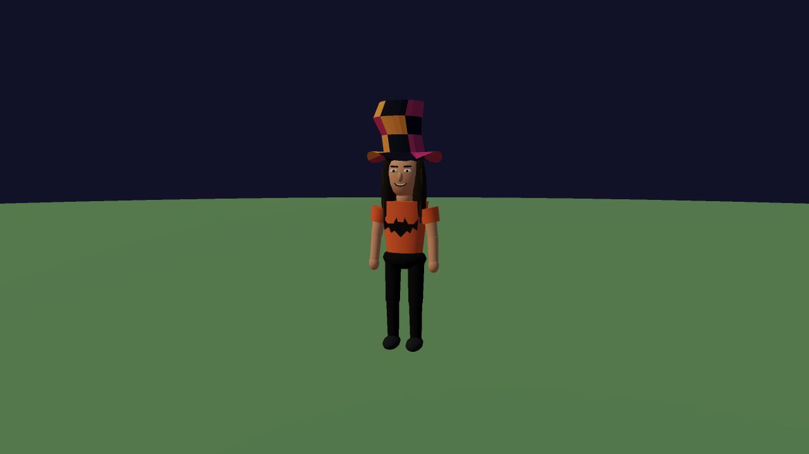
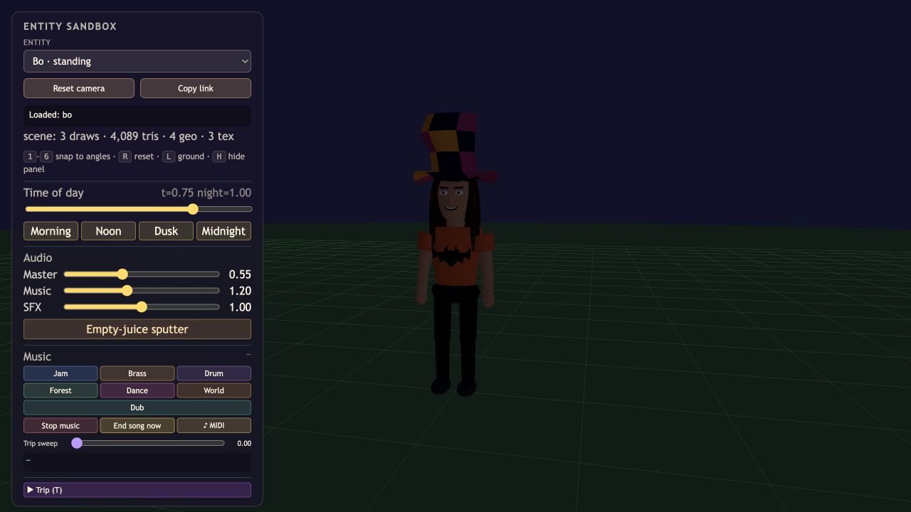
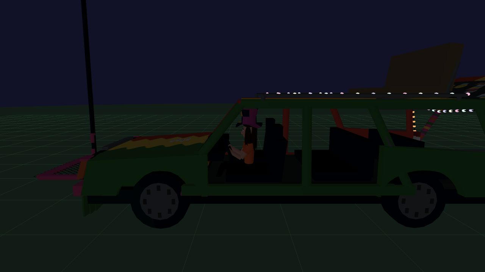

# Bo, Nut Wagon driver

The two photos supplied by Gary guide the long brown hair, light skin and floppy patchwork hat. His explicit clothing choices are black pants and an orange shirt with a black bat. The model uses the game's stylized proportions, with a smiling face and no sunglasses so his face remains visible.

## Integration

`src/models/bo.js` provides standing and seated forms, each with one pooled, vertex-colored mesh and one shadow caster. The bat is geometry rather than a texture. The seated origin is the cushion, facing +Z, with bent knees and hands at the steering wheel. The wagon attaches him at its driver mount at 0.55 model scale, which becomes 0.88 at the gameplay wagon's 1.6 scale. The tall hat fits below the roof.

The crowd still owns the permanent driver reservation and riding behavior. Its generic driver body and optional camera are hidden while Bo is attached, avoiding duplicate bodies. The wagon removes Bo with its root on despawn without disposing shared resources.

## Verification

Follow-up: the seated hips are raised 4 cm in wagon-local coordinates, with knees beyond the cushion and feet in the footwell. The side view below shows the corrected legs. The brief Sol-medium post-commit pass of `444d84d` reported no concrete runtime or lifecycle blocker before that agent reached its quota limit.

The project check passed. Controller checks pass 31 assertions on Low and Standard, including shared resources, driver attachment, roof clearance, hidden generic body and repeated despawn cleanup. The muted Low game boots with Bo's wagon without captured console warnings/errors. The standing Low sandbox reports three scene draws and 4,089 triangles including its ground/background; this is not a whole-game performance benchmark.

- [Standing preview](http://127.0.0.1:8765/sandbox.html?entity=bo&mute=1)
- [Seated preview](http://127.0.0.1:8765/sandbox.html?entity=bo_driving&mute=1)

