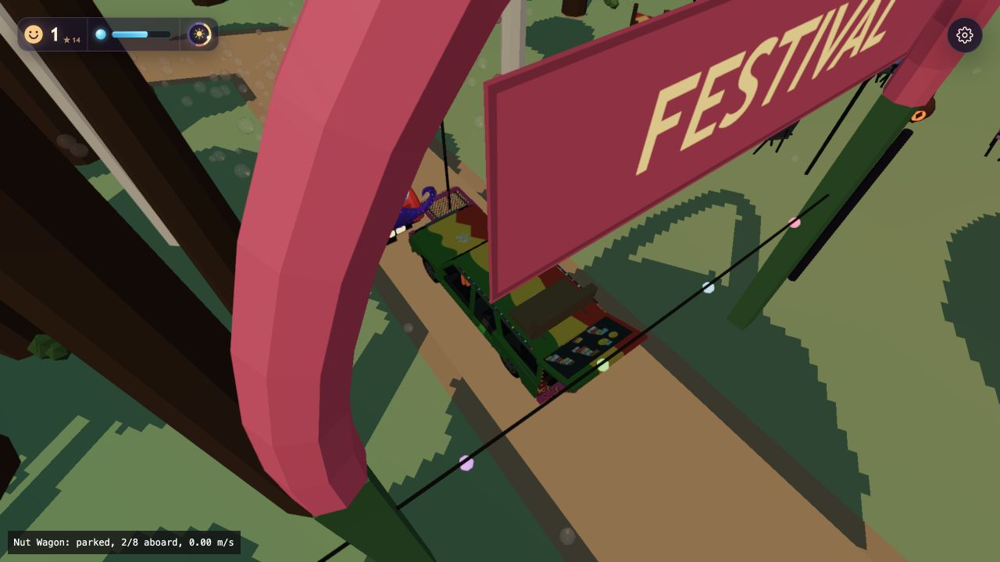
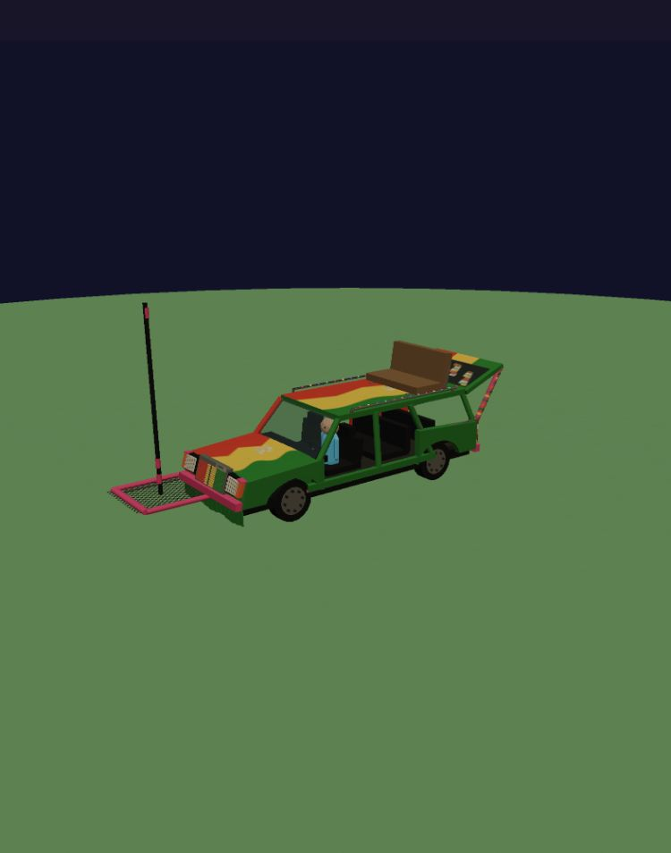
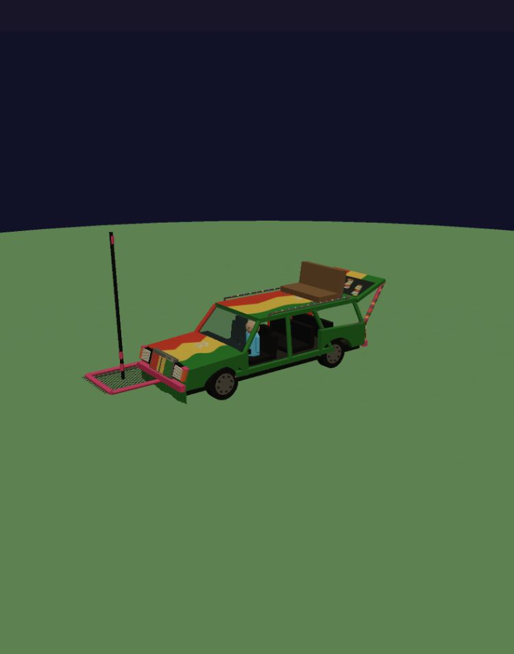

# Nut Wagon first playable version, 2026-10-13

Gary chose rare ordinary encounters, strongly increased Trip encounters, regular passengers before monk groups, and walking-pace cruising with gathering stops.

## Shipped parameters

- One active wagon, in the default worldgen-v2 festival.
- First ordinary roll after eight seconds; subsequent rolls every 45 seconds. 8% normally, 80% in a Trip, plus one immediate roll when a Trip starts. A successful roll still needs a safe off-camera road, so these are roll probabilities, not guaranteed sightings.
- Spawn candidates 65–145 m away; at over 245 m the wagon can recycle when outside the camera view. A local preview can bypass random/off-camera gates.
- Existing road runs, sampled every two metres and rejected around water/hard colliders. No cross-country shortcuts. The wagon shuttles within one valid run rather than navigating the entire road graph.
- 0.75 m/s cruising, 24-second stops near three or more NPCs or a registry activity attractor, with a 48-second driving fallback between stops. Gathering stops must be at least 12 m from the previous stop. It yields near Zerble and stops advancing into newly blocked space.
- Eight seated mounts: one permanent driver and seven passenger places. Regular nearby idle/walking/watching NPCs reserve seats while parked; boarding times out after seven seconds. Tall NPCs use the roof bench because of enclosed-cabin headroom. The platform remains free until standing poses are implemented.
- The gameplay root is scaled 1.6× to suit the existing cartoon crowd. The reference-sized model and dimension constants remain unchanged. Seat transforms and collision radii follow this scale.
- Existing seeded `dub` music generator, not a newly composed reggae track. The panner and distance-fade coordinates follow the wagon; global volume/mute settings apply. No audible audition was performed, honoring silent iteration.
- Regular NPC ride timers are reused; riders leave only at a parked stop. Wagon passengers do not count against Zerble's capacity, produce Zerble boarding rewards, or leave because Zerble's bubble tank empties.

## Iteration surfaces

- [Cruising and boarding preview](http://127.0.0.1:8765/sandbox.html?entity=nut_wagon_cruise&mute=1), with a following orbit camera.
- [Local game preview](http://127.0.0.1:8765/?seed=1234&perf=low&mute=1&nutwagon=1), with an occupancy/speed overlay and following camera. Use the normal Start button.
- `__dbg.nutWagon()` and `__dbg.summonNutWagon()` use the production controller.
- [Controller checks](system.html?perf=low&mute=1) import the real Three.js library and production Crowd methods. Music uses its deferred pre-initialization path and does not make sound.

## Verification

The follow-up [Sol-medium adversarial review](adversarial-review.md) found and resolved clearance and stalled-route defects. Rotated footprints now cover the body, hatch and platform, with sub-metre water sampling. After eight seconds blocked, the wagon parks and reverses along its route without a U-turn. It also uses reverse gear at route ends. Both saved browser runs now pass 25 assertions, including blocked-route and narrow-corridor recovery.

`npm run check`, import-map validation, syntax checks and whitespace checks passed. The automated route test covers interpolation, duplicate points, endpoint clamping, dense obstruction splits, short/blocked route rejection and the tenfold encounter-probability ratio.

[Low](system-low.json) and [Standard](system-standard.json) browser checks cover separate capacity, a permanent driver, ordinary boarding, tall rider placement, moving seat/collider/music coordinates, no disembarking in motion, parked release, repeated despawn cleanup, immediate Trip rolls without per-frame repeats, and full-pool rollback. The model-only GPU checks remain in the adjacent model record.

The real game at seed 1234 booted on Low and Mid, showed a driver and organic passenger, and entered cruising at 0.75 m/s without captured console warnings/errors. Mid's initial scripted start-button input timed out; direct Return to the focused button succeeded. No standalone browser process or new server was launched.

Mid's full-scene debug snapshot showed 60 FPS, 1,173 draws and 1,117,062 triangles, above the existing 200-draw/400k-triangle target. This is not an isolated wagon A/B benchmark or a claim of mobile performance. The model itself adds 54 mesh batches, 9,838 geometry triangles and four shadow casters, with a single active wagon cap. Further whole-scene performance work remains outside this feature's verification.

## Saved views

