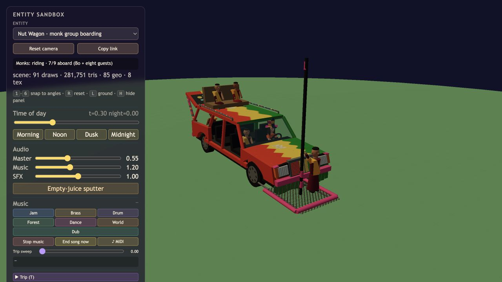
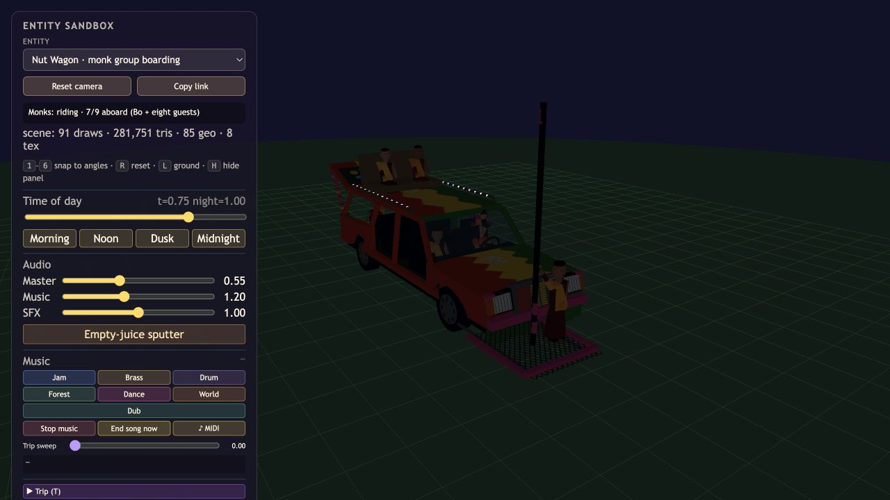
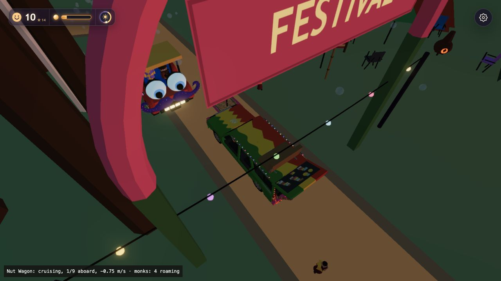

# Monk party verification, 2026-10-13

## Behavior

One party of four to six monks initially appears beside a clear Nut Wagon encounter. Members wander with individual offsets around a shared destination, regroup when spread exceeds 12 metres, and wait while a member uses a bathroom or picnic seat. Nearby food trucks, picnic tables, stages and bathrooms influence destinations. Food-truck visits are wandering destinations, not a new food-purchase simulation.

The party can ride either vehicle if every member is within 14 metres, everyone is available and enough unoccupied places exist. Seats are reserved together and riding begins only after the last member arrives. Movement during boarding or a 22-second deadline cancels all reservations. Rides last 45–70 seconds, followed by disembarking at a stop and a 65-second boarding cooldown. Zerble still needs bubble juice; parties that exceed his free capacity stay together on foot.

The wagon provides eight guest places plus Bo. Party reservations favor the pole platform, roof and trunk. Regular passengers can occupy remaining places. Monks remain in the world if the wagon disappears, and only recycle collectively when all are distant.

The model uses pooled geometry, maroon robes, saffron wraps, closely cropped hair, seated draping and a raised platform arm. Paint boundaries now have four waves/spikes per panel.

## Evidence

- [Low party results](monks-low.json) and [Standard party results](monks-standard.json): 31 assertions each, including real walking-to-boarding, all-or-none reservations, capacity refusal, interrupted boarding, moving riders, amenities, cleanup and shared resources.
- [Low wagon results](system-low.json) and [Standard wagon results](system-standard.json): 31 assertions each, rerun after enabling all eight guest places.
- npm run check passed, including the final 41-test suite; import maps and syntax checks passed.
- The main game at seed 1234 on Low booted through the title button, spawned four monks and showed all four riding beside a regular passenger, with no captured console warnings or errors.
- Sol-medium adversarial review found no confirmed runtime defect. It identified missing release documentation in implementation commit b276774; this follow-up updates the changelog, roadmap, architecture and debugging guide without rewriting that existing commit.
- All browser checks used mute=1. No standalone browser or new server was started.

## Rendering limits

The isolated monk preview reported eight scene draws and 1,735 triangles including the scene. The six-monk wagon preview reported 91 draws and 281,751 triangles, including the existing Crowd instanced capacity. These are scene totals, not the monk model's isolated incremental cost. Existing full-game performance remains above its documented budget; this verification does not establish mobile performance.

## Saved views

## Remaining feature discussions

A custom reggae composition and shared-destination passenger quests remain on the roadmap. Group boarding and wandering work independently of those future features.
