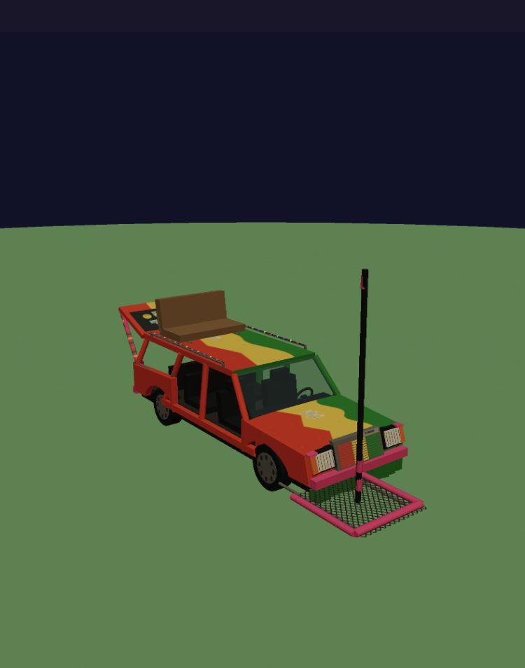
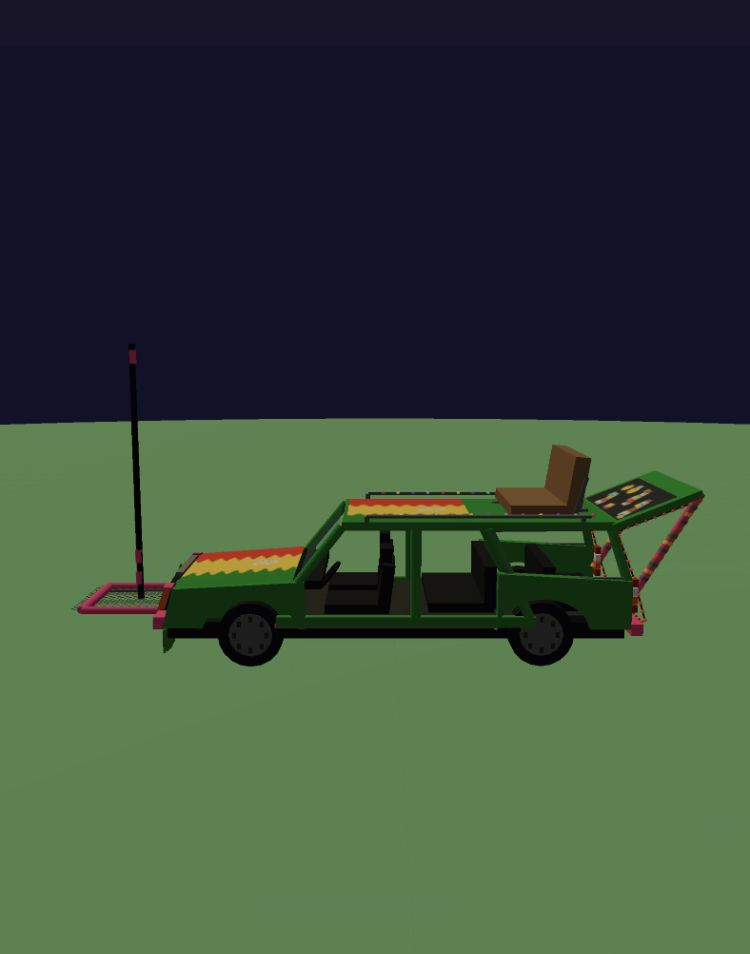
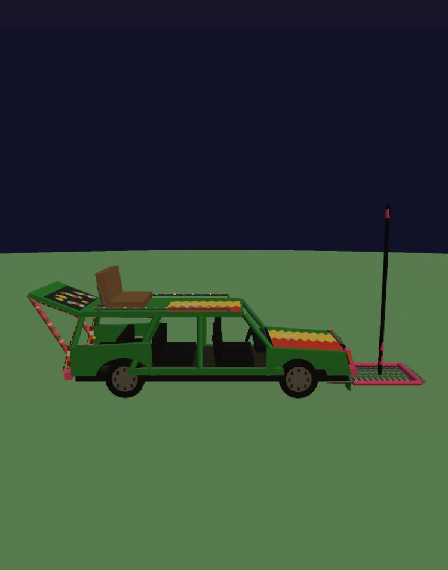
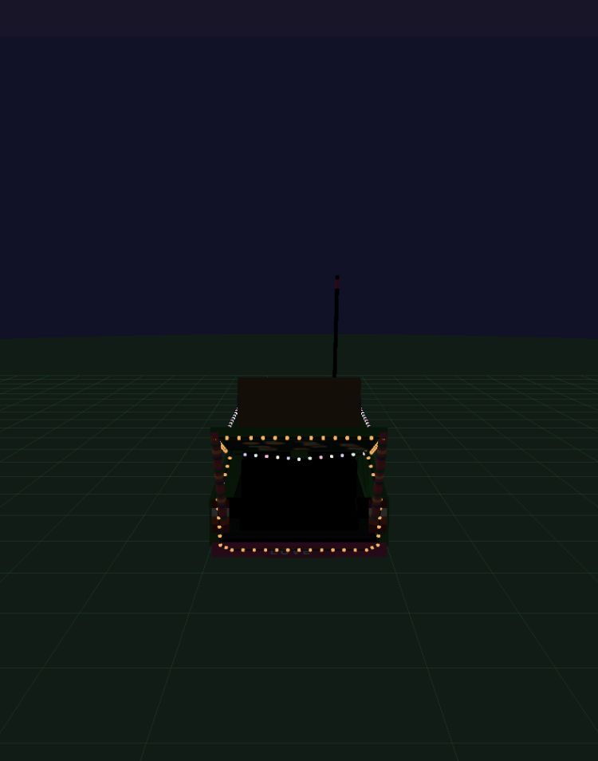

# Nut Wagon model pass, 2026-10-12

The first model is ready for proportion and detail review in the entity sandbox. It is not yet a world-roaming vehicle. Driving, collision registration, boarding, NPC groups, riders and music remain the next discussion, as requested by Gary.

## Inspect

Use the existing no-cache development server:

- [Open hatch](http://127.0.0.1:8765/sandbox.html?entity=nut_wagon&mute=1)
- [Closed hatch](http://127.0.0.1:8765/sandbox.html?entity=nut_wagon_closed&mute=1)
- [Low-tier checks](http://127.0.0.1:8765/verification/nut-wagon/check.html?perf=low&mute=1)
- [Standard-material checks](http://127.0.0.1:8765/verification/nut-wagon/check.html?perf=mid&mute=1)

The check page imports the real Three.js library through the production tier shim, renders one frame and disposes its renderer/context. It does not launch a standalone browser or keep an animation loop running. The ordinary entity sandbox uses Standard materials independently of the game shim, so the check page explicitly covers the Low Lambert path.

## Reference interpretation

The source is Gary's supplied Nut Wagon brief and the seven Downloads images saved on October 12, 2026, with filenames `ChatGPT Image Oct 12, 2026, <time> PM.png`:

- `12_31_24` and `12_31_18`: asymmetric passenger-side mesh platform, centrally mounted pole, pink foam, front paint boundaries, fringe and normal road wheels.
- `12_31_05`: missing side doors, visible cabin, roof rails and roof-seat arrangement. Gary specifically asked about the missing doors; the model uses open doorways matching the visible references.
- `12_30_51`: tan forward-facing rooftop seat and exposed metal mounting.
- `12_31_31` and `12_31_11`: raised sticker-covered hatch, patterned supports, exposed rear structure, cargo riding space and “following Corn” lettering.
- `12_31_37`: front rider and roof riders in the photographed monk encounter.

Photographs remain in Gary's Downloads folder and are not bundled as game textures. Painted textures are generated locally with Canvas, using simplified stickers and hand-painted color regions. This is an initial low-poly interpretation, not an exact historical sticker or trim reconstruction.

The three additional references supplied later in this conversation supersede the original rear lettering and clarify the angled cargo opening, dark interior and rear rope lights. The bumper now reads “LOVE,” the rooftop seat sits farther back, and the roof front is aligned with the windshield pillars.

The additional near-side profile (`codex-clipboard-bf3d5277-3e61-4170-b893-9aad9cd20887.png`) guides the silhouette, hood slope and wheel openings. The donor appears to be a Mercedes S123 estate; the exact engine/year is unconfirmed. [Mercedes' 300 TD archive specification](https://mercedes-benz-publicarchive.com/marsClassic/de/instance/ko/300-TD--S-123-D-30-1978---1986.xhtml?oid=5380) gives a 4.725 m length, 1.786 m width, 1.470 m roof-rail height and 2.795 m wheelbase, with 1.488/1.453 m front/rear track. These guide the shell calibration; the wheelbase and track are set directly. Altered bumpers, accessories and body contours remain photo approximations, not surveyed dimensions. Proportions are baked into shared buffers, with round tyres and corresponding model-local rider mounts.

Bo clarified the paint intent: his driver side is green with a wavy boundary, Courtney’s right side red with a sharp boundary, and mellow yellow between. The full roof, hood, body sides and hatch follow that assignment. Gary requested fewer crests; both boundaries now have two broad cycles per painted panel. The additional colors cost four material batches and one shadow caster.

## Model contract

[Source](../../src/models/nutWagon.js) exports `buildNutWagon({hatchOpen = true})` and `NUT_WAGON_MOUNTS`. It returns a ground-anchored Group, facing +Z, with passenger side at -X. Callers own position and rotation.

The template is lazily built once. Static geometry is batched by material and shadow flag, while each wheel and the hatch retain independent transforms. All retained geometry, materials and generated textures are tagged `userData.shared`; ordinary sandbox/world disposal must skip them. Rider mount arrays are copied per instance and contain named model-local seat/standing positions, facing and pose hints. The platform standing mount is offset beside the central pole so the rider does not occupy its base. A small black rear-facing cargo bench places both cargo mounts at its approximately 0.60 m cushion surface. The nine mounts include the driver and are provisional geometry attachment points, not a promised gameplay capacity.

The hatch-open option controls its initial pose and support visibility. A future animated hatch controller must update both. Music and headlight beams are not attached. `setNutWagonNightness(root, nightness)` drives five pooled emissive colors from the global day/night cycle; the sandbox calls it each frame. The orange rear-opening/hatch string and colored cargo bulbs follow the new rear photograph. The roof-rail string is an additional design choice, not a claim of exact placement in the blurred night photograph. There are no additional real lights or shadow casters.

## Verification

- `npm run check`: passed, exit 0.
- `bin/check-importmaps`: passed, 46 source modules, 12 worldgen modules and 31 models across four entry pages. The model cache-buster entry was added to all four pages.
- `node --check src/models/nutWagon.js` and `git diff --check`: passed.
- Real-Three checks: independent model/hatch/wheel transforms, open/closed support visibility, independent rider mount data, finite attributes, bounds, shared buffers, unload convention, reload reuse, resource budgets and GPU shader compilation. [Low results](check-low.json), [standard results](check-standard.json).
- Model: 54 meshes, 9,838 geometry triangles, four shadow casters. Single-frame renderer probe: 55 submissions / 9,840 triangles, including the transparent double-sided windshield pass. These are model costs, not whole-game FPS measurements.
- Bounds with the hatch open: 2.025 m wide, 3.088 m tall including the pole, 6.317 m long including the platform and raised hatch.
- Full game: Low title screen and world startup verified through the real start button, with no captured console errors or warnings. The model is not yet spawned by that path.
- Sandbox: Noon, Midnight, rear cargo opening, closed hatch and repeated entity selection inspected. Browser sound was muted at Gary's request.

## Saved views

Sandbox time continues advancing after a preset; captures were taken immediately after selecting the preset. No task-owned server or standalone browser process was left running; the existing server on port 8765 was reused.
