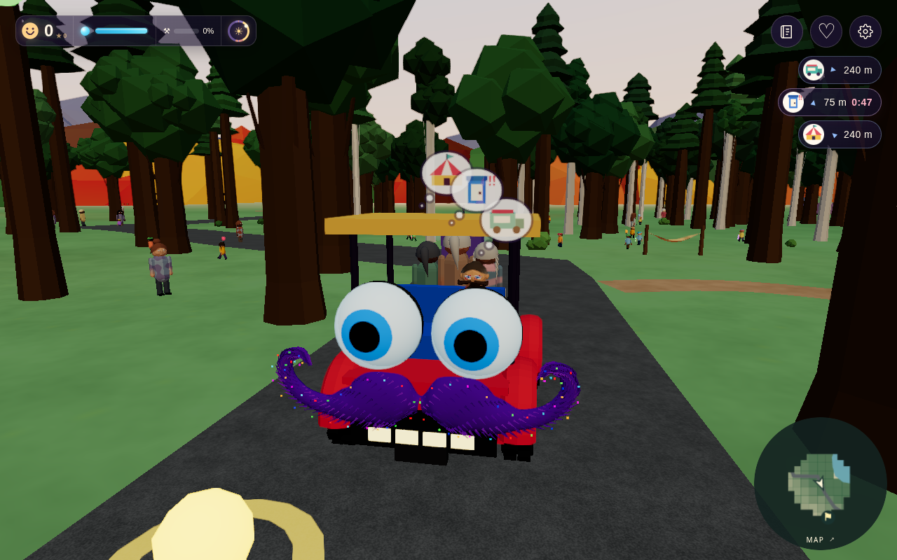
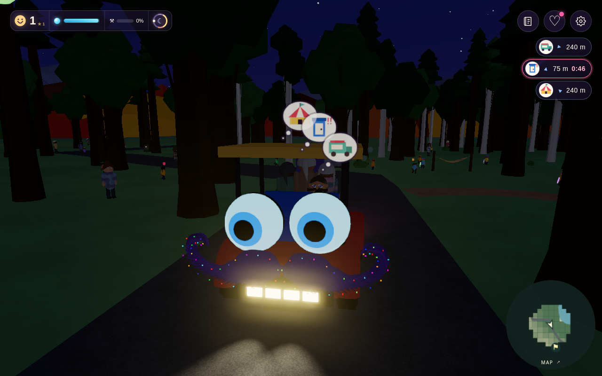
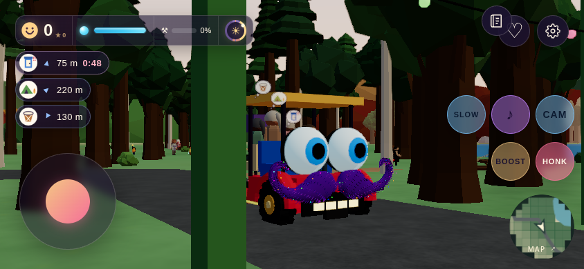
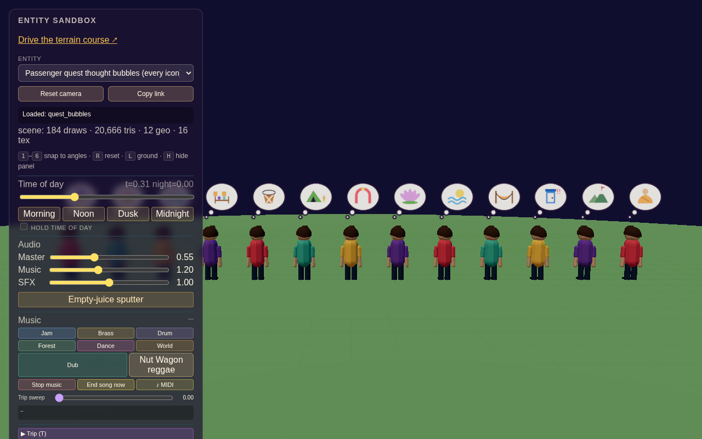
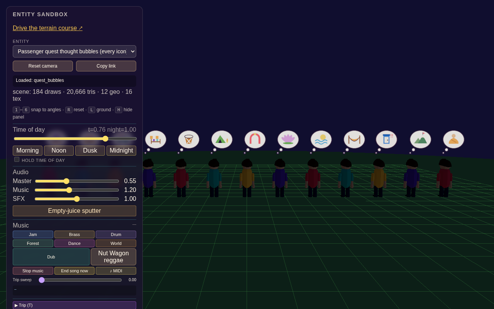
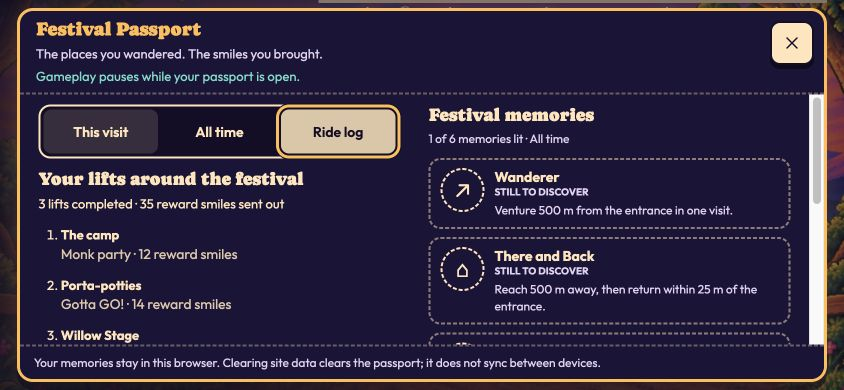

# Passenger quests verification

The original results below were recorded 2026-11-15 on the `passenger-quests` branch. The [integration follow-up](#integration-review-and-native-browser-follow-up) records subsequent checks on the combined implementation. The feature itself is
described in [the change record](../../openspec/changes/passenger-quests/README.md),
its [design notes](../../openspec/changes/passenger-quests/design.md), the
[capability spec](../../openspec/specs/passenger-quests/spec.md) and the
[architecture section](../../ARCHITECTURE.md). This page records what was
measured and, just as important, what was not.

## Method

* `node bin/test-passenger-quests` exercises the browser-free rules: the
  catalog, destination picking, offers, arrival, missed stops, patience,
  remarks, the urgent run, summit and party rewards, the mountaintop source
  (including that it never asks the planner for new work) and the compass math.
* `npm run check` and `npm run build` passed after the core loop and again
  after the presentation slice, and a third time after the variants (urgent squirm, mountaintop, monk party). This checkout runs Node 22 although the
  project asks for Node 24.
* The real game was booted through the real title card and a mode-plank click
  at `/?mute=1&perf=low`, in headless Chromium on software WebGL (SwiftShader),
  with the console watched for errors. Every run was muted.
* The entity sandbox was opened at `sandbox.html?entity=quest_bubbles&mute=1`.

## Results

**Core loop, seed 1234.** A forced urgent request was offered, `__dbg.questGo()`
reached the stop, the rider left and 15 smiles reached the HUD. Zero console
errors.

**Presentation, seed 1234.** Three simultaneous requests showed three thought
bubbles, three compass chips and a flag on the minimap, at day and at midnight.

**Monk party, seed 1977.** A five-monk party boarded Zerble and received one
shared request ("my camp"). `questGo` reached it, the party left together and
the toast read "The monks leave you with a quiet smile." with +15.

**Destination search cost.** The search took 0.4 ms in the running game, where
the plans are already warm. A fully cold Node process took 0.4 to 1.3 s for a
900 m reach, so the reach should not be widened without measuring again.

**Touch layout.** At 844x390 (phones are landscape only) the compass strip sat
at left 22 to 158 px and top 74 to 186 px, clear of the toast and the touch
buttons.

**Icon sandbox.** All 13 icons rendered at Noon and Midnight with zero console
errors.

## Limits and not yet verified

* No real GPU and no physical phone were used. Software rendering says nothing
  about frame rate, so no performance claim is made.
* Audio cues (ask, hum, arrive, fail) were not heard; every run was muted.
* The mountaintop request was not seen in the live game. No admitted Mountain
  Top district was within range on seeds 1234 or 1977, so only its Node test ran.
* The urgent rider's squirm pose was not seen. Software rendering ran too slowly
  to read the motion.
* A rider walking into a porta-potty after an urgent success was not seen.
* A failed urgent run was not played in the live game.
* Mid and High tier boots were not run for this feature.
* The effect on the Festival Run economy and the leaderboard ceiling was not
  measured.

## Addendum: hailing, ride log and quest-earned bubbles (same day)

Seed 1234, Low, software WebGL, zero console errors. A person began hailing for the vendor row within seconds of the crowd appearing, and a destination search from their position took 1.3 ms. Parking beside them (`__dbg.hailGo()`) brought them aboard with that same request, and `questGo` delivered them. A forced urgent run was then delivered: the log read two rides (one ride, one urgent), the record was present in `localStorage`, and Relief Bubbles were reported as earned.

Not verified: how noticeable a hailer's bubble and wave are from the chase camera at 30 to 75 m, the three other new bubble types' unlocks in the game, how any of the four new bubbles look when emitted, and the mountaintop waypoint in the live game (Node test only).

## Integration review and native browser follow-up

On November 15 the pushed branch tip `2277934` was reviewed against `558c9f3` by gameplay, rendering, audio, performance, sandbox and documentation specialists. [Review summary](../../openspec/changes/passenger-quests/reviews/001-branch-audit/review-summary.md). The integration preserves the current Lantern Night UI, translucent driving map and cornhole activity ownership.

Fixed regressions now have executable coverage: physical arrival must succeed before completion/reward; rejected safe landing retries while maintaining the rider's seat and hold; claimed participants cannot hail or board concurrently; reduced motion suppresses entrance spring and urgent tint; quest-chip Space keeps native button activation without reaching gameplay input. Ride-log tests cover persistence, bounded history and save failure while retaining in-memory records.

The managed in-app Browser ran the isolated production build, with every game started through the ready title button and every URL muted. A live hailer boarded, two ordinary deliveries and one urgent delivery completed, and the log recorded 3 rides and 33 reward smiles. A later urgent request expired without adding a ride, although its flee pose and penalty toast were not individually captured. Explicit `perf=low`, `perf=mid` and `perf=high` boots had no captured console warnings/errors. The initial delivery run used Auto: its `tier=low` URL was not a valid quality override, and its captures are not evidence of Low. These are functional checks, without a calibrated GPU or frame-time measurement.

The Ride log was opened through the actual Passport control after delivery. Populated, empty and saving-unavailable fixture states also passed, and keyboard End selected the third tab. At 844×390 there was no horizontal document overflow, with the close button and storage footer outside the scrolling body. The quest-bubble sandbox rendered at Noon and Midnight on explicit Low without captured console warnings/errors.

[Browser receipt](integration/browser-receipt.json) · [Live deliveries](integration/live-log.json) · [After timeout](integration/after-timeout.json) · [Low request](integration/low-request.jpg) · [Noon icons](integration/sandbox-noon-low.jpg) · [Midnight icons](integration/sandbox-midnight-low.jpg).

The full combined `npm run check`, focused quest/presentation/command regressions, `npm run build` and whitespace checks pass. Physical phone/iPad acceptance, audible cues, hailer legibility at 30–75 m, live summit guidance, the full urgent walk-to-door/flee visual sequence and Festival Run reward balance remain open. Earlier software-rendered observations above are historical evidence rather than current hardware acceptance. No performance improvement is claimed. Test tabs and the temporary integration server were closed; the user's original demo server remains available.
