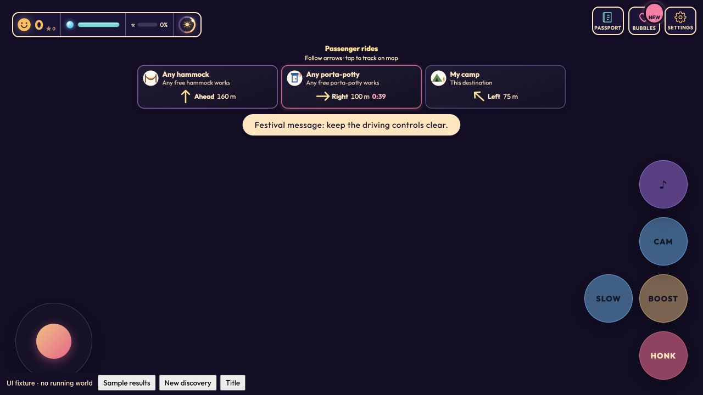
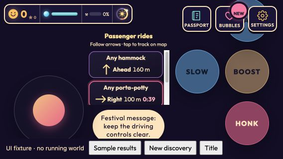

# Passenger destinations and driving guidance

Verified November 15, 2026, using the production build, native title-button
activation and the muted real game on Low, with seed `4077605147`.

## Results

- `npm run check` and `npm run build` passed. The final copy-only change also
  passed `node bin/test-quest-presentation` and a fresh production build.
- Live hammock delivery at `(191, -18)` reserved the tree hammock at
  `(189.31, -0.77)`, despite a different suggested destination. The request
  remained in `handoff` while the passenger was `walking_to_hammock`, with no
  completion, then completed once with six smiles in `hammock_riding`.
  See [walking state](hammock-start.txt) and [entered state](hammock-entered.txt).
- The live urgent ride travelled from the hammock area to the potty at
  `(242.19, -104.65)`. It remained pending in `seeking_potty` with 47.7 seconds
  left, then completed once in `using_potty` with fourteen smiles.
  See [offer](potty-start.txt), [walk-in](potty-arrival.txt) and
  [entry](potty-entered.txt). Noon and Midnight were inspected, and the browser
  reported no warnings or errors during the real-game checks.
- Renderer-free production HUD fixtures showed centered cards, shaft arrows,
  cart-relative Ahead/Right/Left words, and arrival states without arrows.
  At 568 × 320 the panel ended at y=211 and the message ended at y=288.5,
  inside the viewport and between the driving-control banks. The card list
  scrolls on short landscape screens. At 390 × 844 the cards remained within
  the viewport with 110-pixel-wide targets and no horizontal overflow.

## Regression coverage

`bin/test-quest-activities` exercises real Crowd, support bindings and activity
owners: occupied and competing reservations, unsafe exits, a 160-meter ride
whose boarding binding is stale, obstacle detours, alternate hammock access,
dynamic blocked paths, rejected potty interiors, a door that cannot open,
handoff timeout, frozen urgent deadlines, exactly-once settlement, timed return,
cancellation, unload, despawn and interruption. Other focused suites cover
destination-intent cleanup and venue ownership, model anchors, deterministic
forest generation, generic facility selection, HUD disposal/remount, keyboard
activation, shortest arrow rotation and reduced motion.

## Captures and limits

The fixture uses production DOM/CSS without a rendered world. Real-game state
transcripts establish the activity transitions; the top-down world screenshots
are supporting context and do not provide a close-up animation review.
This establishes desktop integration, not physical-phone readability, iOS audio
unlock, subjective reward balance, or measured frame-time impact. Those checks
remain in the roadmap. No performance benchmark was run for this change.
