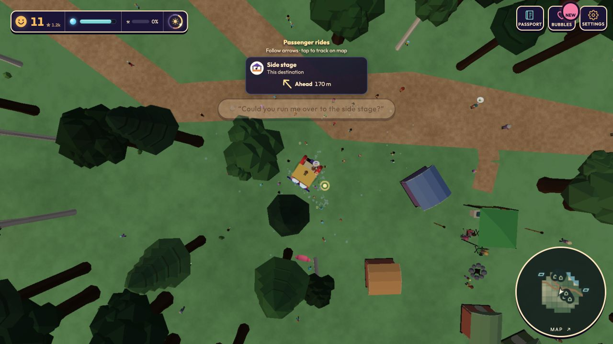
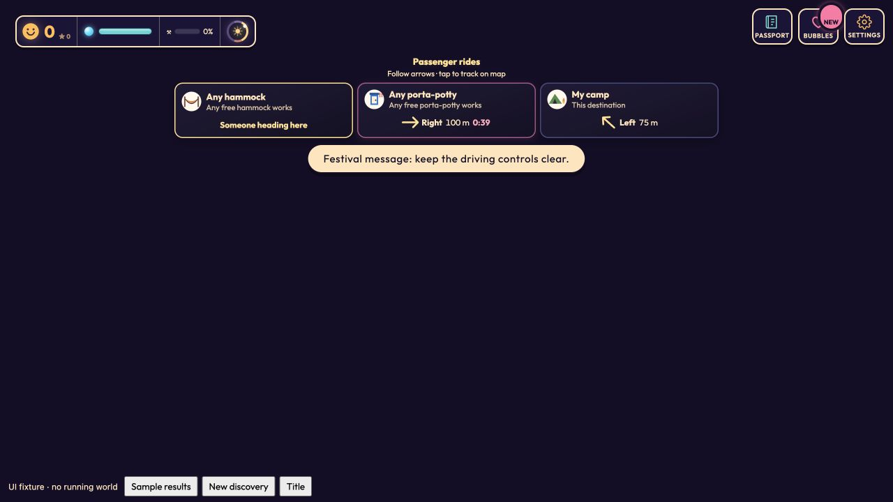

# Hammock rest areas and readable reservations

November 15, 2026.

## Player behavior

An ambient NPC can reserve a hammock only while within 6 m, so a person far
away cannot make an empty sling unavailable. An approaching reservation shows
“Someone heading here”; an actual sleeper shows the occupied guidance. A nearby
visitor retains their turn, and a passenger does not evict them. Delivered
passengers retain their checked route and reservation until entry or cleanup.
Failed admission, walking, swinging or exit motion releases ownership instead
of leaving an invisible claim behind.

Worldgen woods now admit at most one hammock per chunk, using an actual tree
pair beside a residential campsite built in the same chunk. The pocket must be
3–10 m from the pitch edge, dry grass, at most 12% grade, with suitably spaced
trunks and at least 2.4 m of clear fabric span. Both approaches and the walking
corridor must be clear, with separation from roads, woodland paths, dancefloors,
drum access and busy venue entrances. An unsuitable camp gets no hammock.
Freestanding woodland scatter is removed; legacy grove posts also need a camp.

## Verification

`npm run check` and `npm run build` passed.

- `bin/test-rest-activities` covers nearby-only reservation, approach/occupant
  transitions and failed admission, walking, swing and exit cleanup, alongside
  existing ownership and exact ambient motion regressions.
- `bin/test-quest-facilities` and `bin/test-quest-presentation` verify the
  approaching state reaches the player's ride card, while
  `bin/test-quest-activities` retains the passenger handoff and contention checks.
- `bin/test-hammock-placement`, included in `npm run check`, builds real chunks
  for eligible camps, unsuitable camps and uninhabited woods, then unloads and
  rebuilds them. A nine-chunk shrub fingerprint preserves the previous
  undergrowth positions, sizes, rotations and random draw sequence. The existing
  anchor and 4,000-seed forest regressions also passed.
- The production game started through its ready title button on Low with muted
  audio and seed `0`. At `(-326, -82)`, the live registry reported the free
  hammock at `(-326.62, -67.31)`, beside camping tents. Noon and Midnight were
  inspected, and console warning/error inspection was empty.
  [Live registry state](camp-hammock-status.txt).

## Limits

The approaching wording capture is the production HUD fixture; regressions
verify its connection to activity ownership. The live game capture establishes
placement and integration, rather than a watched contention encounter.
Tree density varies by quality tier, so an unsuitable sparse camp may have no
hammock. Same-chunk ownership avoids relying on a neighboring camp being loaded;
the generator retains its existing registry-based scenery admission behavior.
These checks do not establish physical-device performance or readability.
