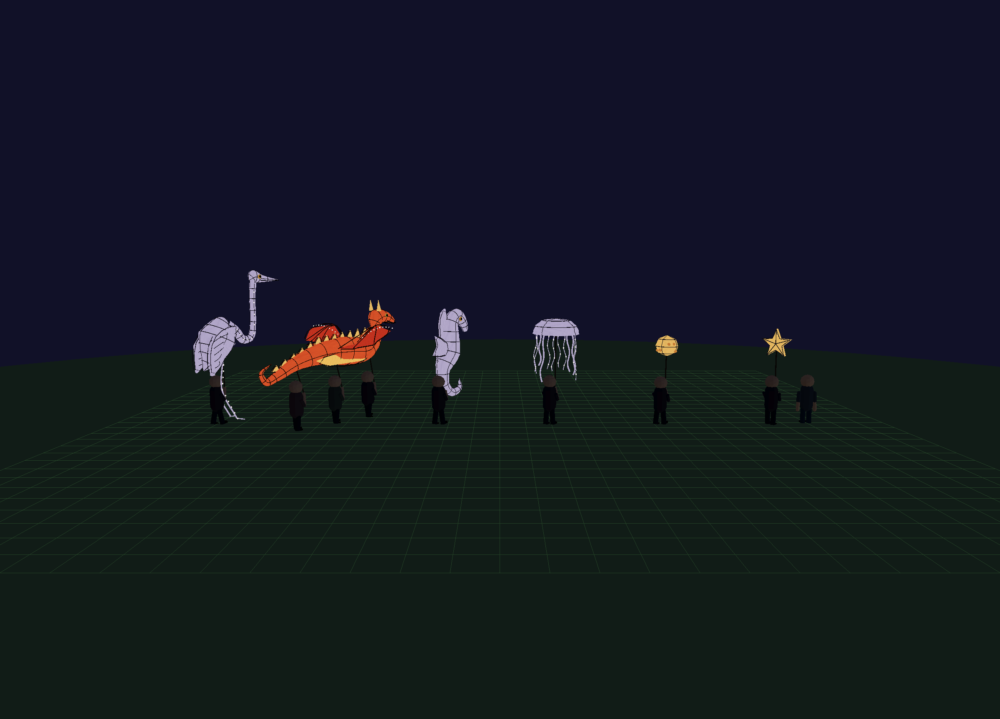

# Street Creature Lantern Parade

**2026-10-12, Astra implementation.** All six subjects now replace the generic parade: heron, three-carrier dragon, seahorse, jellyfish, moon, and star. Gary asked Astra to take over the heron checkpoint and complete the build, then approved the result for commit. Deployment and the device-test limits below are separate from that approval.

## Look First



- [Heron at Midnight](heron-high-midnight.png), [Noon](heron-high-noon.png), and [Sol's starting point](sol-heron.png).
- [Dragon at Midnight](dragon-high-midnight.png) and [Noon](dragon-high-noon.png).
- [Seahorse](seahorse-high-midnight.png), [jellyfish](jellyfish-high-midnight.png), [moon](moon-high-midnight.png), and [star](star-high-midnight.png).
- [Nighttime in the actual game](game-high-midnight-clear.png), [Low-tier daylight game](game-low-noon.png), and [390px mobile-layout heron](heron-mobile-low.png).
- Heron motion samples at [0](heron-pose-0.png), [0.45](heron-pose-0.45.png), [0.9](heron-pose-0.9.png), and [1.35](heron-pose-1.35.png) seconds. The numerical test checks 121 poses per subject, not just these four stills.

The original five photographs remain in Gary's planning conversation, visible to Astra during this implementation. They are not redistributed here. The heron now uses the deep lower neck bend, small yellow eye, long split bill, folded wings, and illuminated angular legs from Photo 1. The dragon uses the warm belly, ribbed red shell, thin wings, dorsal triangles, curled tail, and visible team from Photo 5. The seahorse and jellyfish follow Photos 4 and 5. These are stylized approximations, not claims of exact real-world dimensions or engineering.

## Reproduce

Run `python3 .claude/serve_nocache.py 8765`, or reuse the existing no-cache server.

- `http://127.0.0.1:8765/sandbox.html?entity=puppet_heron&perf=high`
- Replace `heron` with `dragon`, `seahorse`, `jellyfish`, `moon`, or `star` for individual views.
- `http://127.0.0.1:8765/sandbox.html?entity=puppet_lineup&perf=high`
- `http://127.0.0.1:8765/sandbox.html?entity=puppet_parade&perf=high` runs the production controller with a fixed route, no recycling, and a following orbit camera.

Single models use seed 1; lineup/controller use roster indices 0-5. Noon is 0.30 and Midnight is 0.75. The paused 1.8-second gait scrub evaluates the production pose function. `H` hides the panel; close/game-distance buttons restore useful framing. `__sandbox.tod.setT(t)`, `loadEntity(key)`, `entityRoot`, `cam`, and `renderer` support repeatable captures. The lineup includes one extra comparison human, so its scene counters differ from the model-only totals.

## Verification

- `npm run check` passed after the roster and controller changes. Existing Node typeless-package warnings remain; no package-type/build change was introduced.
- Real Three.js checks passed on Low, Mid, and High in [results.json](results.json): identical seeded geometry; finite vertices/normals/bounds/transforms; 121 poses per subject; pole grip and shell endpoints within roughly `6e-15` m; root-transform preservation; `dt=0`; stable geometry/material identities through animation; day/night emissive response; 1,800 controller steps spanning the loop; eight collider attachments; scatter; and relocation reusing the same model objects.
- Seven consecutive lineup rebuilds on each tier stayed at **121 GPU geometries and four textures**, including the sandbox. The only new texture is a shared 64x64 procedural paper texture, not an externally loaded asset.
- Low/Mid/High main-game real Start-button runs rendered and advanced with no recorded console errors; see [game-results.json](game-results.json). The first High night angle was occluded by a tree, so `game-high-midnight-clear.png` records a later clear angle rather than hiding the obstruction in the scene.
- A manual Low-tier real-resolver contact drill changed cart speed from 10 to -2.5 after one stepped frame at a heron collider. An attempted automated repeat in a random world timed out, so it was removed rather than counted as a pass. Repeatable cross-mode hit/SFX checks are not established by this manual drill.
- Browser renderer: **ANGLE Metal, Apple M4 Pro**, not software WebGL. The owned named browser was closed and its recorded daemon/browser/GPU process IDs were confirmed gone. The pre-existing local server was left running.

## Cost and Limits

[baseline.json](baseline.json) reconstructs six original models directly from git ref `d505cb9` in the same real Three runtime, without altering the worktree:

| Model-only total | Original six | New six |
|---|---:|---:|
| Mesh submissions | 180 | 176 |
| Triangles | 15,888 | 69,886 |

The new geometry is more detailed but batched by material and articulated part. This is a submission/geometry comparison, **not an FPS claim**. No lights, transmission, extra render passes, or puppet-shell shadow casters were added. The sandbox has no bloom; the game uses its existing quality policy. Physical iPhone performance and matched before/after full-game frame timing remain unmeasured.

The current path placement, speed, scatter, and relocation policy are retained. Routes can pass through woodland, as the game captures show; this pass does not add obstacle-aware routing. The larger dragon's three carriers have explicit ground circles rather than an oversized wing collider. Distinct collision feedback at every carrier in both game modes still warrants gameplay testing.

## Test Tools

With an explicitly owned `agent-browser` session already open on the sandbox:

```sh
ZERBLE_BROWSER_SESSION=<session> npm run test:puppets
ZERBLE_BROWSER_SESSION=<session> node verification/puppet-parade/capture.mjs
ZERBLE_BROWSER_SESSION=<session> node verification/puppet-parade/baseline.mjs
ZERBLE_BROWSER_SESSION=<session> node verification/puppet-parade/game-capture.mjs
```

These tools use bounded commands and do not launch a browser. The caller owns session creation and must close it in a `finally` cleanup or immediately after the run, including failures. The browser-dependent geometry test is deliberately separate from the offline `npm run check`; extending the Node geometry stub would not verify real meshes or transforms.
