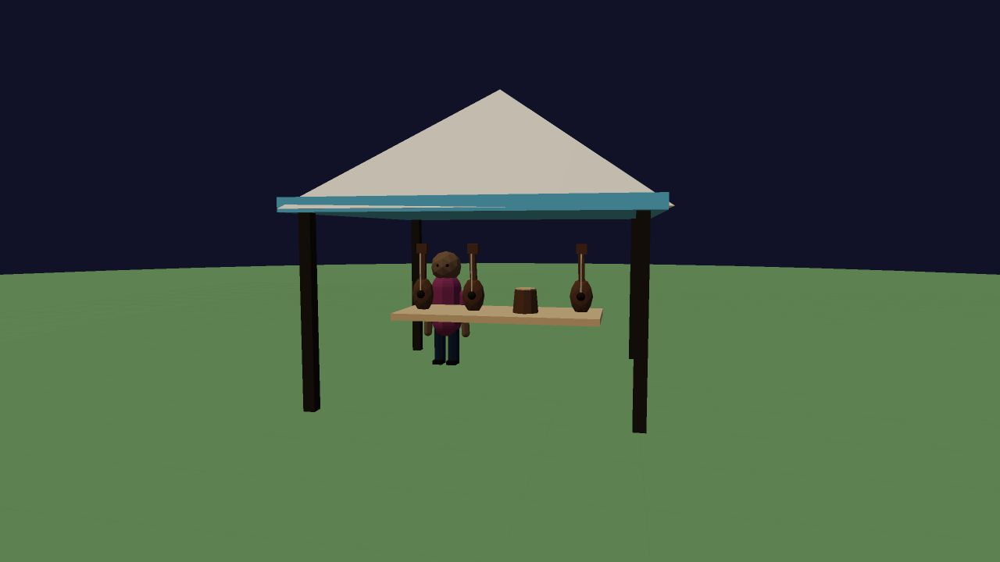
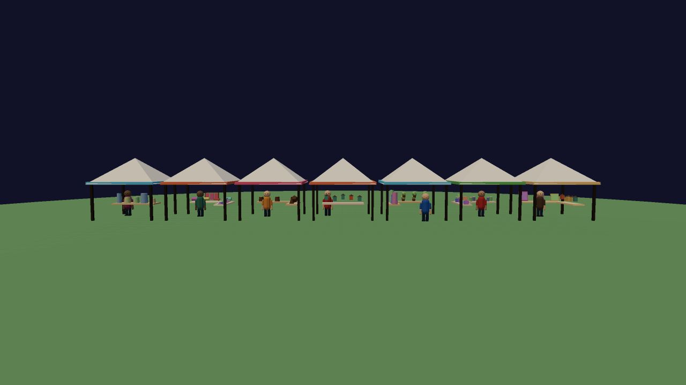
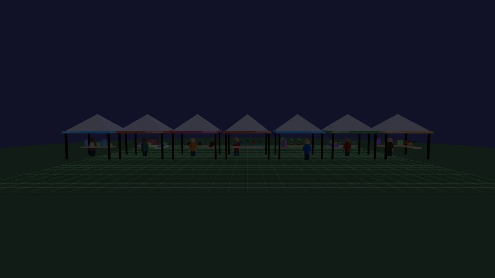

# Vendor tent variety verification, 2026-10-14

Seven trade profiles use the production tent builder: pottery, textiles, instruments, lanterns, plants, jars and paintings. Each guarantees its primary merchandise on the first table and mixes complementary goods elsewhere. New display shapes include hanging fabric swatches, rolled textiles, upright stringed instruments, hand drums, lanterns and carved goods. Existing U, L, back and center booth footprints remain.

## Checks

The real-Three.js [browser fixture](check.html) passed:

- 64 seeds preserve caller RNG draw counts against the historical one-argument builder.
- All seven profiles repeat identical geometry with identical caller and merchandise seeds.
- Primary merchandise is present, and displays stay inside the existing 4.5m booth footprint.
- At most two extra mesh draws and 3,000 extra triangles per tested booth compared with its same-seed legacy build; no more than three shadow-casting meshes.
- Shared resources remain tagged and reused across builds.

The low-tier instrument preview and mid-tier seven-stall preview rendered without warnings or errors; Noon and Midnight were inspected. The main game booted through its title button at seed 932033385 with no warnings or errors. These are bounded model/startup checks, not extended drive performance measurements. The full project check passed during integration, followed by the actual-model fixture after the final material change.

## Preview

- `sandbox.html?entity=tent_row&perf=mid&mute=1`
- `sandbox.html?entity=tent&vendor=instruments&perf=low&mute=1`
- The `vendor` parameter accepts the seven IDs listed above.

The draw-only legacy merchandise helper preserves the seeded world stream. Any edits to the six historical layout functions must keep its draw schedule aligned; run the browser fixture when changing them.
