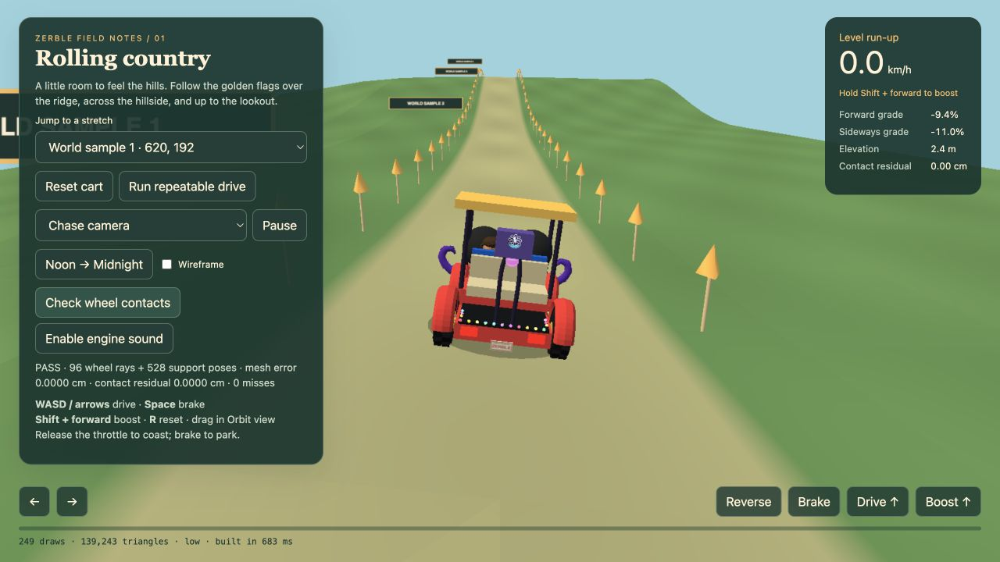

# Rolling terrain integration, October 25, 2026

## Scope and entry points

This is an opt-in integration checkpoint, not default-release acceptance.
Use `/?mute=1&terrain=1&seed=1977`,
`hub-sandbox.html?mute=1&terrain=1&seed=1977`,
`map-sandbox.html?mute=1&terrain=1&seed=1977`, or
`terrain-sandbox.html?mute=1&surface=world&seed=1977`.
The authored driving course remains available without `surface=world`.

The canonical service is `src/worldgen/terrain.js`: fixed 10m triangles,
independent randomness, bounded caches, level zero-datum gathering/camp pads and
lake collars, and rolling country between them. The game ground no longer
subtracts its moving center height. Roads conform to that same surface; this
checkpoint does not yet supply independent road-approach grading.

## Automated evidence

`npm run check` completed with exit 0 on October 25, including importmaps and all
existing regression commands. New suites cover world terrain, consumer grounding,
movers, map work budgets, festival rejection predicates, tent support planes and
grass world-UV invariance. Existing tests that evaluate source in isolated contexts
were updated with explicit flat terrain mocks.

`bin/test-terrain` preserves the 30/60/120Hz repeatable drive, ending at
z=-383.041309664504. `bin/test-terrain-grounding` covers three root yaws,
contact on a sloping plane, repeated fitting without drift, independent prop
heights, and fixed UV coordinates across positive and negative 40m recentering.
These are numerical regressions, not substitutes for visual shelter acceptance.

## Browser and user evidence

The real game was started through its title/mode controls with terrain enabled,
then driven near seed 1977, x=620, z=-20. No console errors were observed in that
smoke check. This does not establish every camera, mode or device.

The shared-world driving harness on Low displayed PASS for 96 wheel rays plus
528 support poses, zero misses, mesh error 0.0000cm and contact residual 0.0000cm.
Its displayed workload was 249 draws and 139,243 triangles, built in 683ms.
Those are harness counters and one allocation observation, not full-game FPS or
a device-performance comparison.

Gary reported smooth desktop/mobile play of the authored course and positive
initial full-game `terrain=1` play, then identified incline tent contact and grass
shifting. The fixes in this checkpoint respond to those observations. No fresh
full-game iPhone acceptance or visual approval of the tent fix is claimed.

## Terrain-contact fixes

`src/campRegistry.js` independently grounds camp props and fits sleeping tent
shells to a sampled support plane, retaining pooled geometry. Seats and child
registry positions use local surface height. Rigid tents cannot perfectly follow
arbitrary nonplanar creases, and standalone event/vendor tents need visual audit.

`src/world.js` now uses negative world Z in the texture V offset because rotating
PlaneGeometry onto the ground reverses its local V direction. The previous
positive offset doubled the recenter phase change instead of cancelling it.
The regression evaluates both production offset expressions at fixed world points.

## Remaining release acceptance

The [active checklist](../../openspec/changes/varying-elevation/tasks.md) retains
road grading and corridor checks, collision-height audit, complete camera checks,
repeated unload/revisit lifecycle checks, fresh flat/terrain Noon/Midnight tier
comparisons, and full-game mobile/iOS performance acceptance. Keep terrain opt-in
until these pass. The [layout research review](2026-10-24-layout-research-review.md)
records the narrow placement fix and separates research recommendations from proof.
