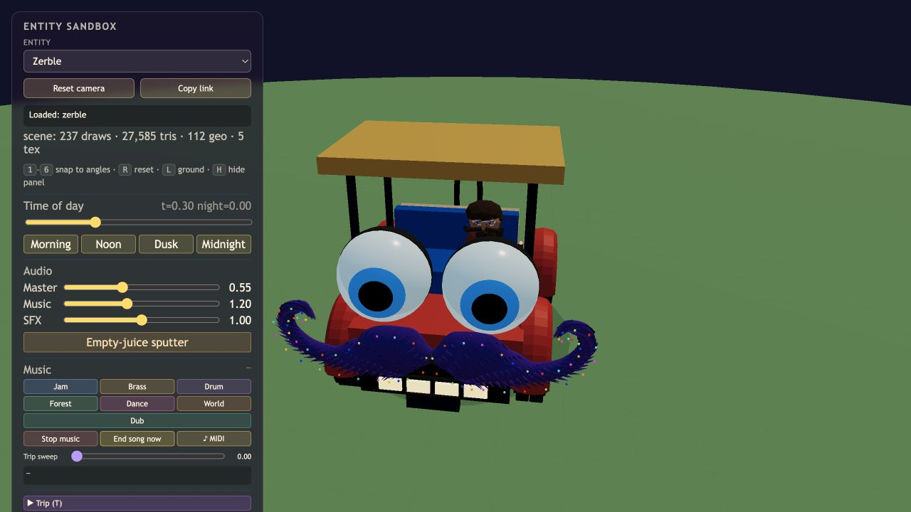
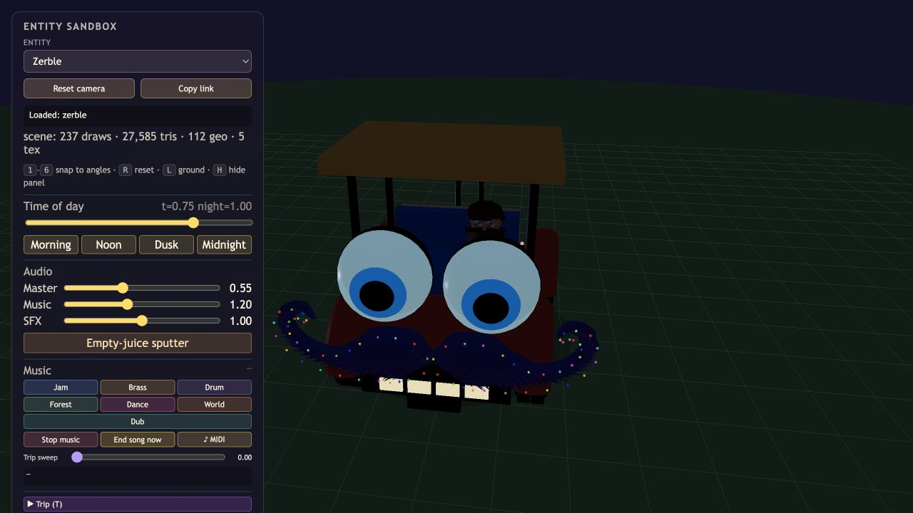

# Curved eye surfaces

The iris and pupil now use spherical caps centered on the white eyeball, with radii 0.702 m and 0.704 m over the 0.7 m sclera. Their projected radii remain 0.4 m and 0.24 m. A shared yaw animation rotates both around that center instead of translating the pupil away from the globe. The iris is opaque so white emission does not wash out its blue color.

Verified the Standard sandbox at Noon and Midnight from front and side views, including the shallow side silhouette. The scene reported 237 draws and 27,585 triangles; no new shadow casters or draw calls were introduced. The two eyes reuse their cap geometries within each cart. A muted Low-tier main game loaded its title screen and started without captured console warnings/errors. JavaScript syntax and git whitespace checks passed.

